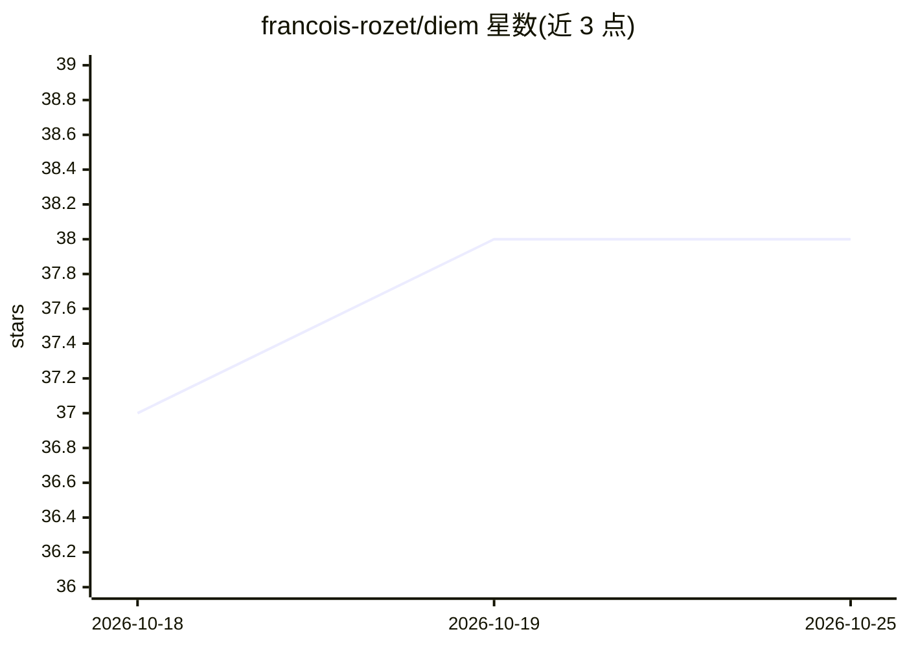

# francois-rozet/diem

⭐ 38 · Python · MIT · 推送 2026-03-19 · [GitHub](https://github.com/francois-rozet/diem) · [官网](https://arxiv.org/abs/2405.13712) · 个人维护

**论文官方实现：仅从不完整噪声观测训练扩散先验（EM 算法）**

DiEM 论文（Learning Diffusion Priors from Observations by Expectation Maximization）的官方代码库。基于期望最大化算法，从仅有不完整且含噪的观测中训练扩散模型作为贝叶斯逆问题先验，并提出针对无条件扩散模型的改进后验采样方案。代码以 Python + JAX（Inox）实现，依赖 conda 环境文件管理；实验涵盖 manifold、CIFAR-10 与 fastMRI 加速磁共振重建，运行需 Slurm 集群与 Weights & Biases 账号。面向复现论文实验的科研用户。

## 筛选速览

| 维度 | 判定 | 备注 |
|---|---|---|
| AI 角色 | `ai-native` | 本体是模型或模型工具 |
| 许可风险 | `permissive` | MIT |
| 部署形态 | `library` | 以包/库形式分发 |
| 模型依赖 | — | README 未给出锁定关系 |
| 硬件要求 | — | 无带数字的原话,不猜 |
| 安装摩擦 | `low` | 无编译、无系统依赖或容器化 |
| 成熟度 | — | 结构信号不足 |

## 能力要点

- 基于期望最大化从不完整噪声观测训练扩散模型
- 改进的无条件扩散模型后验采样方案
- JAX/Inox 实现，附 CIFAR-10 与 fastMRI 实验脚本及论文图表 notebook

## 适用场景

- 复现论文中流形、CIFAR、fastMRI 实验
- 在仅有噪声观测数据时训练扩散先验
- 研究贝叶斯逆问题的后验采样方法

## 场景标签

`科研工具` `模型训练` · 领域:学习与行业

## 证据(README 行号)

> L3: This repository contains the official implementation of the paper Learning Diffusion Priors from Observations by Exp
> L7: Diffusion models recently proved to be remarkable priors for Bayesian inverse problems. However, training these mode
> L11: The majority of the code is written in Python. Neural networks are built and trained using the JAX automatic differ

## 星数曲线

2026-10-18 37 → 2026-10-25 38（+1）

---
*卡片 v1 · prompt 1.4 · 生成 2026-10-25 · 置信度 mid · 依据 README sha `bff04efebef3` · [字段定义](../../DATASET.md)*
