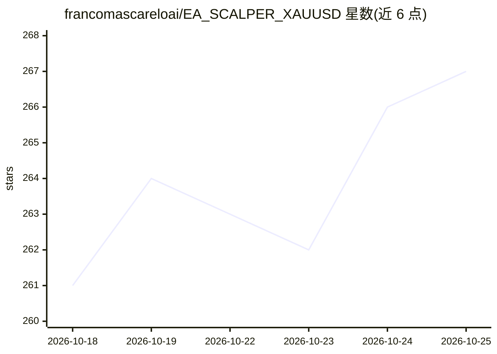

# francomascareloai/EA_SCALPER_XAUUSD

⭐ 268 · MQL5 · NOASSERTION · 推送 2026-06-21 · [GitHub](https://github.com/francomascareloai/EA_SCALPER_XAUUSD) · 个人维护

**XAUUSD 黄金自动交易研究项目：公开 MQL5 代码供学习协作**

一个进行中的 XAUUSD（黄金）自动化交易公开研究仓库，发布 MQL5 快照供学习、分析与工程协作，明确声明非成品、不承诺盈利、禁止实盘或接入经纪商执行（见 TRADING_RESTRICTIONS.md）。作者称先分析了 5000+ 个交易机器人再动手；私有部分为 Python/NautilusTrader 回测与执行栈，探索 SMC 概念、ML 市场状态检测与 ONNX 推理（尚未端到端接入）。PR 范围限于文档/CI/工具/重构，需签 CLA。

## 筛选速览

| 维度 | 判定 | 备注 |
|---|---|---|
| AI 角色 | `ai-enhanced` | 去掉 AI 部分产品仍成立 |
| 许可风险 | `none` | NOASSERTION |
| 部署形态 | `None` |  |
| 模型依赖 | — | README 未给出锁定关系 |
| 硬件要求 | — | 无带数字的原话,不猜 |
| 安装摩擦 | `low` | 无编译、无系统依赖或容器化 |
| 成熟度 | `idea` | |

## 能力要点

- 公开可读的 MQL5 Expert Advisor 与指标代码快照
- 私有侧含策略/执行/风控/回测（walk-forward、Monte Carlo）等在研模块
- 研究 prop-firm 约束（Apex/FTMO 风格）下的架构
- 明确限制：仅教育与协作用途，禁止实盘执行

## 适用场景

- 学习与审计一个真实交易 EA 的 MQL5 代码结构
- 参与文档、CI、工具与重构方向的工程协作
- 研究 prop-firm 约束下的自动交易架构设计

## 场景标签

`金融量化` · 领域:学习与行业

## 证据(README 行号)

> L45: - **MQL5** — MetaTrader 5 Expert Advisors and indicators (this snapshot).
> L47: - **SMC concepts, ML regime detection, ONNX inference** — explored and being validated, not all wired end-to-end ye

## 星数曲线

2026-10-18 261 → 2026-10-25 267（+6）

---
*卡片 v1 · prompt 1.4 · 生成 2026-10-22 · 置信度 mid · 依据 README sha `56d8cd1de274` · [字段定义](../../DATASET.md)*
