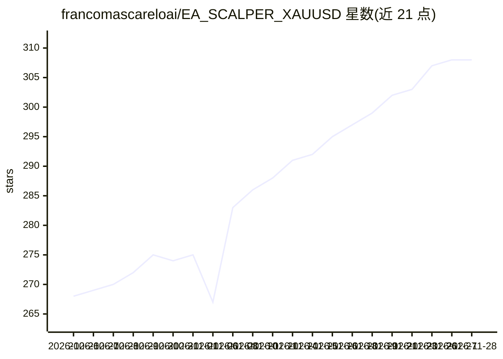

# francomascareloai/EA_SCALPER_XAUUSD

⭐ 308 · MQL5 · NOASSERTION · 推送 2026-11-19 · [GitHub](https://github.com/francomascareloai/EA_SCALPER_XAUUSD) · 个人维护

**个人 XAUUSD 量化交易研究实验室的公开 MQL5 快照**

单人维护的金融系统工程实验室，公开部分为 MQL5 Expert Advisors 与指标，Python/NautilusTrader 核心私有。提供逐事件确定性回测（SHA-256 校验）、MetaTrader 5 与 NinjaTrader 8 平台集成、统计验证（walk-forward、block-bootstrap Monte Carlo、Probabilistic/Deflated Sharpe Ratio、PBO）与 fail-closed 设计。作者声明仅回测、从未实盘、不提供信号与盈利承诺，禁止实盘或券商连接使用。开发过程中由作者协调多个 AI 编码代理并行工作并经双人审查整合。

## 筛选速览

| 维度 | 判定 | 备注 |
|---|---|---|
| AI 角色 | `ai-enhanced` | 去掉 AI 部分产品仍成立 |
| 许可风险 | `none` | NOASSERTION |
| 部署形态 | `None` |  |
| 模型依赖 | — | README 未给出锁定关系 |
| 硬件要求 | — | 无带数字的原话,不猜 |
| 安装摩擦 | `low` | 无编译、无系统依赖或容器化 |
| 成熟度 | `idea` | |

## 能力要点

- NautilusTrader 逐事件回测，SHA-256 确定性重放校验
- MetaTrader 5 (MQL5) 与 NinjaTrader 8 (C# AddOn) 平台集成
- 统计验证套件：walk-forward、Monte Carlo、Deflated Sharpe Ratio、PBO
- AI 编码代理并行开发，git worktree 隔离加双人代码审查

## 适用场景

- 研究 XAUUSD 策略的回测与统计验证方法
- 参考 MQL5 Expert Advisor 与 Python 参考实现的对照校验
- 借鉴多 AI 编码代理协作与测试纪律的工程流程

## 场景标签

`金融量化` · 领域:学习与行业

## 证据(README 行号)

> L19: - **Event-by-event backtesting** on NautilusTrader (Python 3.14), with deterministic replay checked by SHA-256 trac
> L28: I coordinate several AI coding agents in parallel. Each lead works in its own git worktree with its own plan, and I

## 星数曲线

2026-10-26 268 → 2026-11-28 308（+40）

---
*卡片 v1 · prompt 1.4 · 生成 2026-11-25 · 置信度 high · 依据 README sha `ea3bc06e275f` · [字段定义](../../DATASET.md)*
