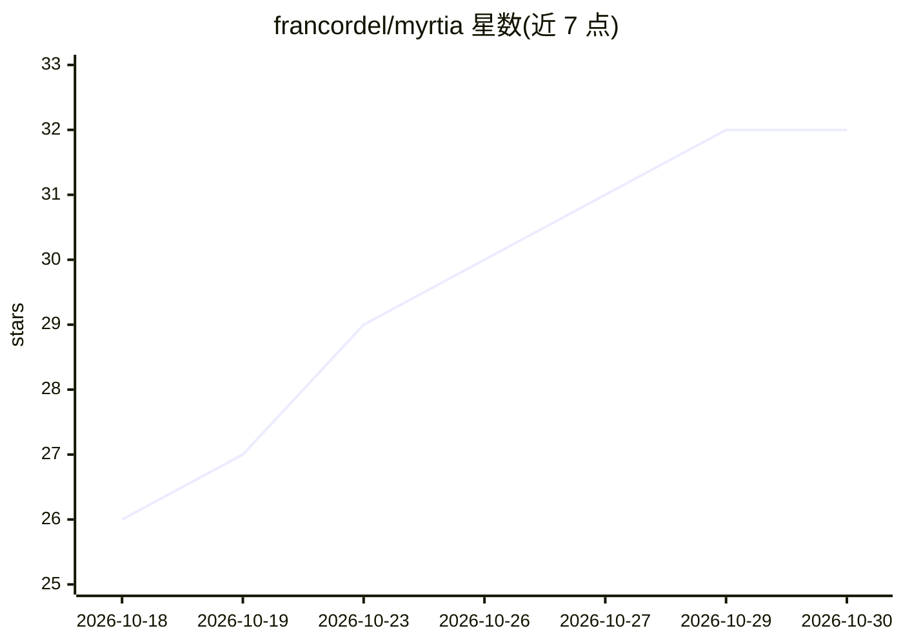

# francordel/myrtia

⭐ 32 · Python · Apache-2.0 · 推送 2026-10-27 · [GitHub](https://github.com/francordel/myrtia) · [官网](https://myrtia.ai) · 个人维护

**面向 LLM 与 AI agent 的红队评估框架，多模型议事会生成攻击**

开源红队框架：编排一个攻击者模型议事会，各模型独立提出对抗提示、互相批评、以 Borda 投票选出候选，由 chairman 合成后发送给目标模型，环内裁判按 0-5 分危害等级评分；全过程逐轮流式呈现于 Web 界面，并汇总为攻击成功率（ASR）分析。内置 19 种攻击（17 种自带 + 2 种来自 ARES Council 插件包），支持 Ollama/vLLM/OpenAI 兼容端点作为各角色后端。基于 IBM ARES 构建，提供 uv 一键安装与 Docker 镜像。

## 筛选速览

| 维度 | 判定 | 备注 |
|---|---|---|
| AI 角色 | `ai-ecosystem` | LLM/agent 周边工具 |
| 许可风险 | `permissive` | Apache-2.0 |
| 部署形态 | `self-host` | docker 或自建部署 |
| 模型依赖 | local-ok | 支持本地模型 |
| 硬件要求 | — | 无带数字的原话,不猜 |
| 安装摩擦 | `low` | 无编译、无系统依赖或容器化 |
| 成熟度 | — | 结构信号不足 |

## 能力要点

- 议事会机制：propose → cross-critique → Borda 投票 → chairman 合成
- 19 种攻击策略，含可视化 agentic 攻击画布（graph）
- 逐轮流式审议 UI 与 ASR 统计分析
- 各角色（council/chairman/judge/target）可分别指向不同 OpenAI 兼容端点

## 适用场景

- 对自有 LLM 或 AI agent 跑越狱/注入类安全评估
- 用多模型议事会自动生成对抗提示并观察审议过程
- 汇总攻击成功率，输出安全评估审计记录

## 场景标签

`模型评测` `网络安全` · 领域:评测与运维

## 证据(README 行号)

> L231: Myrtia is an open-source framework for **red teaming large language models and AI agents**.
> L239: Library and CLI tools such as IBM **ARES** and NVIDIA **garak** are the reference point for LLM
> L246: |Capability|garak / PyRIT / ARES|promptfoo|Agentic Radar (Splx)|Mindgard / Splx platform / Repello|Myrtia|

## 星数曲线

2026-10-18 26 → 2026-10-30 32（+6）

---
*卡片 v1 · prompt 1.4 · 生成 2026-10-26 · 置信度 high · 依据 README sha `d11be1878341` · [字段定义](../../DATASET.md)*
