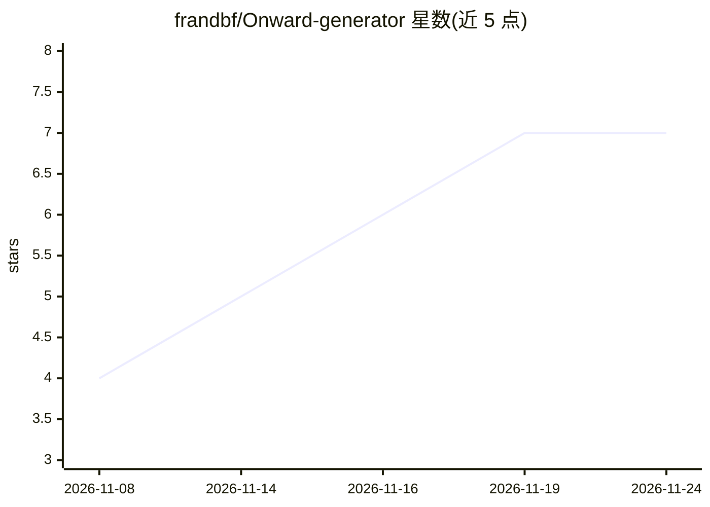

# frandbf/Onward-generator

⭐ 6 · Python · MIT · 推送 2026-11-20 · [GitHub](https://github.com/frandbf/Onward-generator) · 个人维护

**把地球上任意街道生成 Onward（Meta Quest）可玩地图的工具**

从 OpenStreetMap 等开放数据源读取指定经纬度周边的街道、建筑与店铺信息，生成带门面、招牌、道具的 3D 街区，并输出可直接在 Unity（2021.3.23f1）中经 Onward SDK 打包上传到 Quest 头显游玩的地图，含 Free Roam、Hunt 与 Uplink 玩法要素。Python 流水线经 Docker 运行，完全本地执行、无云服务；可选接入本地 Ollama 模型选择纹理与道具，未启用时由确定性规则完成。版本 0.1.0，标注 experimental，头显验收清单尚未完成。

## 筛选速览

| 维度 | 判定 | 备注 |
|---|---|---|
| AI 角色 | `ai-enhanced` | 去掉 AI 部分产品仍成立 |
| 许可风险 | `permissive` | MIT |
| 部署形态 | `library` | 以包/库形式分发 |
| 模型依赖 | local-ok | 支持本地模型 |
| 硬件要求 | — | 无带数字的原话,不猜 |
| 安装摩擦 | `low` | 无编译、无系统依赖或容器化 |
| 成熟度 | `idea` | |

## 能力要点

- 多源数据融合：OSM 街道与名称，法国/西班牙 LiDAR 建筑高度，西班牙 Catastro，全球 Overture places
- 生成完整 Onward 地图：出生点、巡逻路线、机器人、Uplink、天梯、导航网格与烘焙光照
- AI 可选：本地 Ollama（qwen3:14b）选择道具与街景风格，失败回退到确定性规则
- 属性标注 observed/estimated/generated 并记录各数据源许可

## 适用场景

- 为 Meta Quest 上的 Onward 生成真实地点的自定义地图
- 用 LiDAR/Catastro 数据提升特定地区建筑的还原度
- 在本地离线环境跑通地图生成流水线

## 场景标签

 · 领域:游戏工具/GIS 数据转换

## 证据(README 行号)

> L5: Give it a name, a latitude and a longitude. It downloads the real streets and buildings around that point from OpenS
> L27: - **Runs on your machine.** No cloud service. AI is optional: a local Ollama model can choose textures and props; w

## 星数曲线

2026-11-08 4 → 2026-11-24 7（+3）

---
*卡片 v1 · prompt 1.4 · 生成 2026-11-20 · 置信度 mid · 依据 README sha `c6011c48c88f` · [字段定义](../../DATASET.md)*
