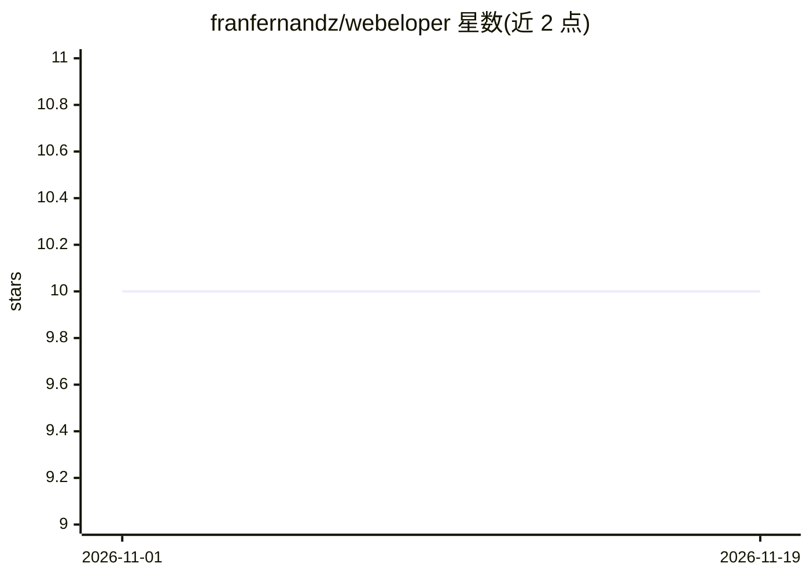

# franfernandz/webeloper

⭐ 10 · MIT · 推送 2026-10-26 · [GitHub](https://github.com/franfernandz/webeloper) · [官网](https://ndzlabs.vercel.app) · 个人维护

**为建站自由职业者提供合同驱动的三代理流程：销售→设计→开发**

Webeloper 是一组运行于 opencode 的 markdown 格式 agent 定义：三个 AI 代理（Sales/Designer/Developer）按固定管线协作，用 sales-contract.md 与 project-contract.md 两份合同文档在阶段间传递上下文，最终产出可演示的客户网站。设计阶段由 design-judgment 技能约束：要求书面视觉论点、探索三个方向并为每个决策给出依据。代理不得在无人批准下对外触达；不是网站生成器或 web 框架，需要人工监督每一步。

## 筛选速览

| 维度 | 判定 | 备注 |
|---|---|---|
| AI 角色 | `ai-native` | 本体是模型或模型工具 |
| 许可风险 | `permissive` | MIT |
| 部署形态 | `None` |  |
| 模型依赖 | — | README 未给出锁定关系 |
| 硬件要求 | — | 无带数字的原话,不猜 |
| 安装摩擦 | `low` | 无编译、无系统依赖或容器化 |
| 成熟度 | — | 结构信号不足 |

## 能力要点

- 三代理管线：Sales→Designer→Developer，合同文档作为各阶段唯一事实来源
- design-judgment 技能强制书面视觉论点与三个差异化设计方向
- 代理不执行未经人工批准的外部触达，事实需可验证
- 以纯 markdown agent 定义与合同模板分发，MIT 许可

## 适用场景

- 为潜在客户从销售线索研究一路推进到网站 demo
- 自由职业者在多项目间保持统一的销售—设计—交付流程
- 让 AI 生成网站时有明确约束与人工控制点

## 场景标签

`多智能体` `编码 Agent` · 领域:Agent 开发

## 证据(README 行号)

> L25: Three AI agents, two contract documents, one pipeline: **Sales → Design → Build**.
> L85: Requires opencode (or any runtime that supports markdown agent definitions).
> L61: 3. **Designer Agent** reads the handoff and produces `project-contract.md`, a complete, build-ready specification. 

## 星数曲线

2026-11-01 10 → 2026-11-19 10（+0）

---
*卡片 v1 · prompt 1.4 · 生成 2026-11-19 · 置信度 high · 依据 README sha `883565ad9d6a` · [字段定义](../../DATASET.md)*
