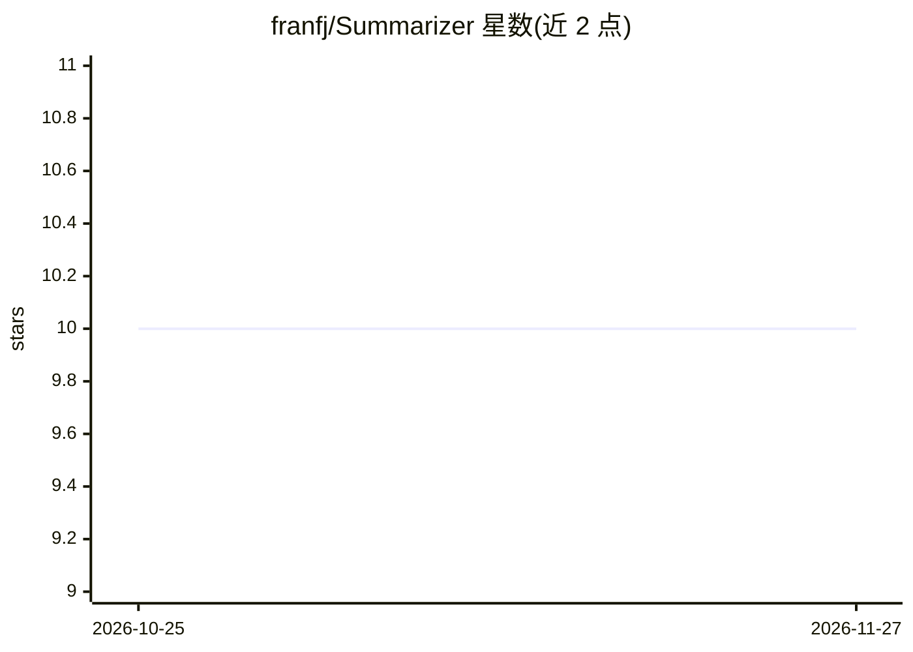

# franfj/Summarizer

⭐ 10 · Python · GPL-3.0 · 推送 2026-04-18 · [GitHub](https://github.com/franfj/Summarizer) · 个人维护

**Python 文本摘要库：抽取式摘要与纲要生成**

一个进行中的 Python 文本摘要库，通过 pip 安装后设置待摘要文本、算法（TextRank）与保留百分比等参数，调用 summarize() 返回摘要段落，或调用 schematize() 返回纲要结构；依赖清单见 requirements.txt。README 说明项目仍在开发中（in progress），文档较简短，未给出算法细节与性能说明。

## 筛选速览

| 维度 | 判定 | 备注 |
|---|---|---|
| AI 角色 | `ai-native` | 本体是模型或模型工具 |
| 许可风险 | `viral` | GPL-3.0 |
| 部署形态 | `library` | 以包/库形式分发 |
| 模型依赖 | — | README 未给出锁定关系 |
| 硬件要求 | — | 无带数字的原话,不猜 |
| 安装摩擦 | `low` | 无编译、无系统依赖或容器化 |
| 成熟度 | `idea` | |

## 能力要点

- 支持 TextRank 算法的抽取式文本摘要
- summarize() 返回段落摘要，schematize() 返回纲要
- 可控制摘要保留百分比（如 0.25/0.5）
- 参数可在属性或函数调用中传入

## 适用场景

- 对长文本按比例自动生成摘要
- 从文本中抽取结构化纲要

## 场景标签

`AI 写作` · 领域:内容生成

## 证据(README 行号)

> L2: Text summarization Python library (in progress)
> L23: summarizer.algo = Summ.TEXT_RANK # Summ.TEXT_RANK is equal to "textrank"

## 星数曲线

2026-10-25 10 → 2026-11-27 10（+0）

---
*卡片 v1 · prompt 1.4 · 生成 2026-11-19 · 置信度 high · 依据 README sha `462ee05c5992` · [字段定义](../../DATASET.md)*
