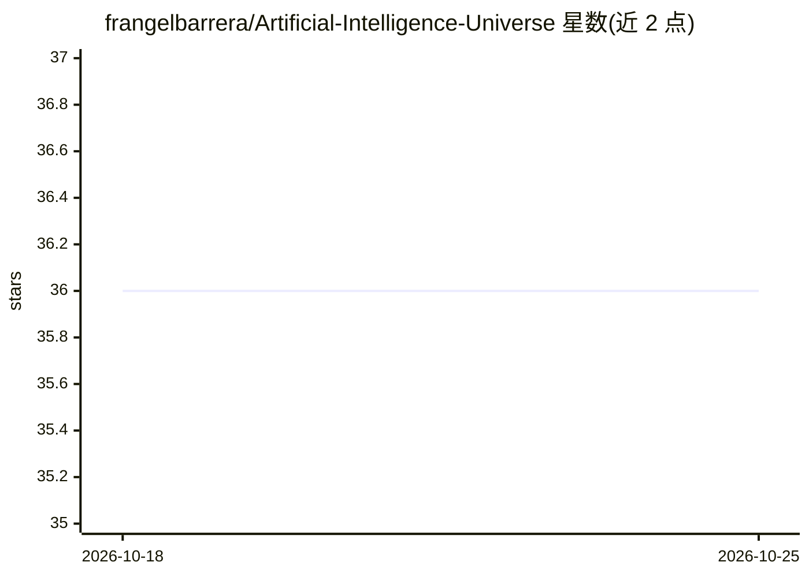

# frangelbarrera/Artificial-Intelligence-Universe

⭐ 36 · MIT · 推送 2026-10-22 · [GitHub](https://github.com/frangelbarrera/Artificial-Intelligence-Universe) · 个人维护 · 中文 README

**AI 工具与模型资源策展清单（700+ 工具，12 大类）**

一个以 Markdown 清单形式维护的 AI 资源目录：收录 700+ AI 工具、agent、模型、MCP 服务器与学习资源，另含 120+ AI 目录类站点，按 12 个核心板块与 70+ 子类组织，覆盖开发工具、文本写作、图像设计、音视频、行业应用、模型与 agent、前沿领域等。附带按日期标注的前沿模型编辑快照表（OpenAI/Anthropic/Google/Moonshot 等），并声明社区投稿按文档化策展标准审核。

## 筛选速览

| 维度 | 判定 | 备注 |
|---|---|---|
| AI 角色 | `ai-knowledge` | 知识聚合/清单类 |
| 许可风险 | `permissive` | MIT |
| 部署形态 | `None` |  |
| 模型依赖 | — | README 未给出锁定关系 |
| 硬件要求 | — | 无带数字的原话,不猜 |
| 安装摩擦 | `low` | 无编译、无系统依赖或容器化 |
| 成熟度 | — | 结构信号不足 |

## 能力要点

- 700+ 工具条目 + 120+ AI 目录资源
- 12 核心板块与 70+ 子类的导航结构
- 带日期与来源链接的前沿模型快照表（声明非排行榜）
- 社区投稿按文档化策展标准审核

## 适用场景

- 按类别查找 AI 工具、agent 或 MCP 服务器
- 查看带来源引用的前沿模型近况
- 寻找其他 AI 工具目录与发现渠道

## 场景标签

`精选清单` · 领域:学习与行业

## 证据(README 行号)

> L10: A curated directory of AI tools, agents, large language models, MCP servers, and learning resources for developers,
> L13: - **700+** curated AI tools, agents, models, and learning resources

## 星数曲线

2026-10-18 36 → 2026-10-25 36（+0）

---
*卡片 v1 · prompt 1.4 · 生成 2026-10-25 · 置信度 high · 依据 README sha `d9b47481d452` · [字段定义](../../DATASET.md)*
