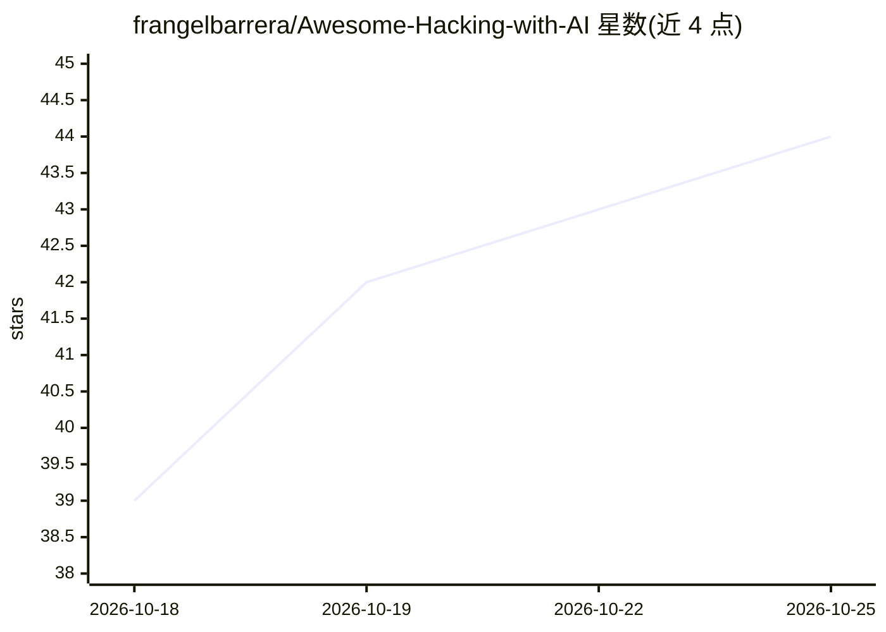

# frangelbarrera/Awesome-Hacking-with-AI

⭐ 44 · Python · MIT · 推送 2026-10-19 · [GitHub](https://github.com/frangelbarrera/Awesome-Hacking-with-AI) · 个人维护

**AI 安全领域策展清单：AI 助攻安全与 AI 系统安全双线资源**

面向安全从业者、AI 工程师、研究者和授权红队的证据导向型资源清单，沿“AI for security”与“security for AI systems”两条路径组织条目：涵盖 LLM/RAG/Agent 安全、MCP 安全、AI 红队与评测、对抗鲁棒性、应用安全与漏洞研究等。每个条目标注类型与适用说明，并附授权使用约束（仅支持经授权、合规的安全测试，不提供未授权访问或恶意用途内容）。资源以表格化目录形式呈现，无安装或运行组件。

## 筛选速览

| 维度 | 判定 | 备注 |
|---|---|---|
| AI 角色 | `ai-knowledge` | 知识聚合/清单类 |
| 许可风险 | `permissive` | MIT |
| 部署形态 | `None` |  |
| 模型依赖 | — | README 未给出锁定关系 |
| 硬件要求 | — | 无带数字的原话,不猜 |
| 安装摩擦 | `low` | 无编译、无系统依赖或容器化 |
| 成熟度 | — | 结构信号不足 |

## 能力要点

- 按 AI for security 与 security for AI 双路径组织资源目录
- 覆盖 LLM/RAG/Agent 安全、MCP 安全、AI 红队评测等主题
- 条目标注类型、用途与成熟度提示，附证据引用
- 明确授权使用边界，指向实验室/基准环境进行测试

## 适用场景

- 为 LLM/RAG/Agent 应用选型安全评测与扫描工具
- 查找 MCP 安全规范、检查清单与扫描器
- 系统学习 AI 红队与对抗鲁棒性评测框架
- 按读者目标（防护/评测/模型适配）导航学习路径

## 场景标签

`精选清单` `网络安全` · 领域:学习与行业

## 证据(README 行号)

> L11: > A curated, evidence-led guide to **AI for security** and **security for AI systems**. It brings together authoriz
> L13: This repository is for security practitioners, AI engineers, researchers, educators, and authorized red teams. It i

## 星数曲线

2026-10-18 39 → 2026-10-25 44（+5）

---
*卡片 v1 · prompt 1.4 · 生成 2026-10-25 · 置信度 high · 依据 README sha `ba0a7e8322cb` · [字段定义](../../DATASET.md)*
