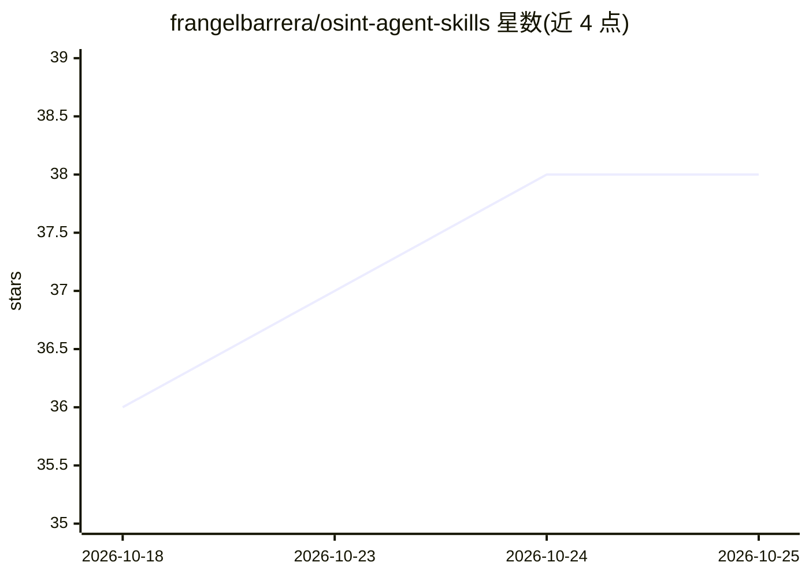

# frangelbarrera/osint-agent-skills

⭐ 38 · JavaScript · MIT · 推送 2026-10-02 · [GitHub](https://github.com/frangelbarrera/osint-agent-skills) · [官网](https://www.npmjs.com/package/@frangelbarrera/osint-agent-skills) · 个人维护

**把任意 AI agent 变成资深 OSINT 分析员的结构化知识库**

面向安全研究人员、威胁情报分析师、记者与尽调团队的知识库，不是 agent 或脚本本身：由系统提示词（约3000字）、方法论、9 个 pivot playbook、免费工具/API 注册表、伦理框架与报告模板组成，供 Claude Code、Cursor、Ollama 等 agent 框架加载消费。内置反幻觉规则、ICD-203 风格报告标准，v1.5.0 起工具响应附带 sha256 output_hash 供下游验证器核对输出完整性。克隆仓库后由 agent 按集成指南接入。

## 筛选速览

| 维度 | 判定 | 备注 |
|---|---|---|
| AI 角色 | `ai-knowledge` | 知识聚合/清单类 |
| 许可风险 | `permissive` | MIT |
| 部署形态 | `None` |  |
| 模型依赖 | — | README 未给出锁定关系 |
| 硬件要求 | — | 无带数字的原话,不猜 |
| 安装摩擦 | `low` | 无编译、无系统依赖或容器化 |
| 成熟度 | — | 结构信号不足 |

## 能力要点

- 9 个 pivot playbook（email/域名/IP/照片地理定位等触发式调查路径）
- 约3000字系统提示词：反幻觉规则、伦理硬拒绝、ICD-203 风格报告标准
- 工具响应含 sha256 output_hash，支持 verify_output_integrity 校验
- agent 无关设计，提供 Claude Code/Cursor/Ollama 等集成指南

## 适用场景

- 让我的 agent 按资深分析师流程对域名/邮箱/IP 做开源情报调查
- 自动化威胁情报收集阶段并产出带引用的结构化报告
- 对 agent 调查结果做输出完整性核验

## 场景标签

`提示工程` `网络安全` · 领域:Agent 开发

## 证据(README 行号)

> L16: It is a **structured knowledge base** — a curated set of methodologies, tool registries, pivot playbooks, ethics ru
> L14: `osint-agent-skills` is **not** an agent. It is **not** a script. It is **not** a SaaS.

## 星数曲线

2026-10-18 36 → 2026-10-25 38（+2）

---
*卡片 v1 · prompt 1.4 · 生成 2026-10-25 · 置信度 high · 依据 README sha `9071883900ef` · [字段定义](../../DATASET.md)*
