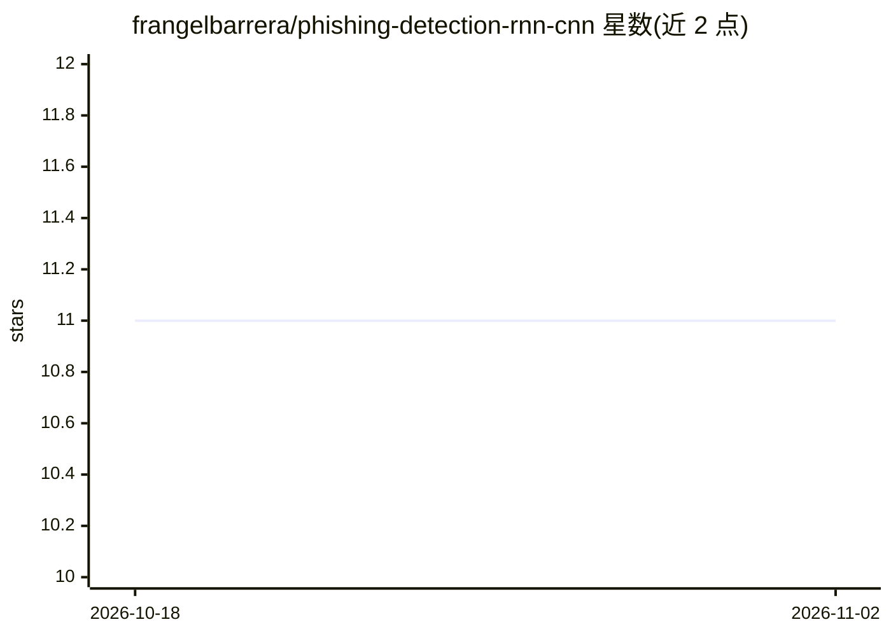

# frangelbarrera/phishing-detection-rnn-cnn

⭐ 11 · Python · MIT · 推送 2026-10-06 · [GitHub](https://github.com/frangelbarrera/phishing-detection-rnn-cnn) · [官网](https://phishing-detection-rnn-cnn.onrender.com/) · 个人维护

**离线钓鱼 URL 分类器：仅凭词法特征判定 URL 是否钓鱼**

轻量级离线钓鱼 URL 检测模型：从 URL 字符串提取 49 个标准化的词法与结构特征（长度、特殊字符数、数字比例、TLD 标记等），推理时不发起任何网络请求，可用于隔离网络环境。main 分支为两层隐层 MLP（约 5,300 参数，TensorFlow 训练），附带 StandardScaler 保证训练/推理预处理一致，测试准确率 89.94%、AUC-ROC 0.965；另保留 CNN+LSTM 原始论文分支。提供 Flask Web UI、CLI 与可复现训练脚本。限制：不检查 SSL/DNS/页面内容，无法检测合法域名上托管的钓鱼页面。

## 筛选速览

| 维度 | 判定 | 备注 |
|---|---|---|
| AI 角色 | `ai-native` | 本体是模型或模型工具 |
| 许可风险 | `permissive` | MIT |
| 部署形态 | `library` | 以包/库形式分发 |
| 模型依赖 | — | README 未给出锁定关系 |
| 硬件要求 | — | 无带数字的原话,不猜 |
| 安装摩擦 | `low` | 无编译、无系统依赖或容器化 |
| 成熟度 | — | 结构信号不足 |

## 能力要点

- 仅 URL 词法特征推理，无网络请求，可离线运行
- 两层 MLP（约 5,300 参数），附带 scaler 消除训练/推理偏差
- 提供 Flask Web UI 与 CLI，模型工件随仓库提交
- 训练全流程可复现（seed 42，含 training_metadata/metrics 记录）

## 适用场景

- 在隔离网络环境中批量筛查可疑 URL
- 作为防御性分析的第一道过滤，输出钓鱼概率供人工复核
- 在自有数据集上复现或重训钓鱼检测模型

## 场景标签

`网络安全` · 领域:学习与行业

## 证据(README 行号)

> L15: A lightweight **offline** phishing-URL detection model. All features are
> L19: The classifier is a small two-hidden-layer MLP (≈ 5,300 parameters) trained

## 星数曲线

2026-10-18 11 → 2026-11-02 11（+0）

---
*卡片 v1 · prompt 1.4 · 生成 2026-11-02 · 置信度 high · 依据 README sha `c8f3affb8863` · [字段定义](../../DATASET.md)*
