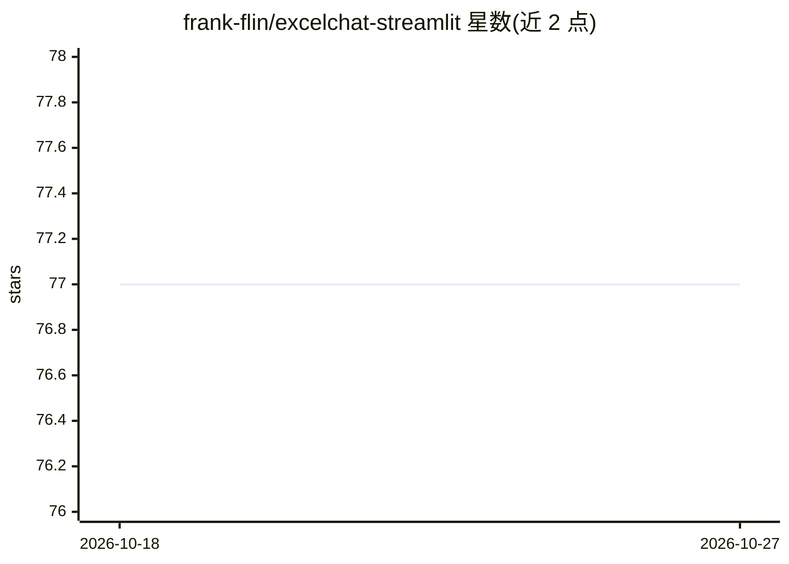

# frank-flin/excelchat-streamlit

⭐ 77 · Jupyter Notebook · Apache-2.0 · 推送 2025-11-06 · [GitHub](https://github.com/frank-flin/excelchat-streamlit) · [官网](https://excelchat.streamlit.app) · 个人维护 · 中文 README

**上传 Excel 文件并用对话查询的 Streamlit 应用**

基于 pandas-ai 与 Streamlit 构建的 AI 应用：用户上传 Excel 文件后，以类似 ChatGPT 的对话方式对数据进行提问，由所选大模型生成回答。支持 OpenAI、Ollama（starcoder:7b、codellama:7b-instruct-q8_0、zephyr:7b-alpha-q8_0）以及百度 Ernie-Bot（AIStudio 单线程模式与 Qianfan 两种接入，后者为推荐方式）。要求 Python 3.9 及以上，通过 pip 安装依赖后以 streamlit run 启动，并提供在线 Demo。

## 筛选速览

| 维度 | 判定 | 备注 |
|---|---|---|
| AI 角色 | `ai-native` | 本体是模型或模型工具 |
| 许可风险 | `permissive` | Apache-2.0 |
| 部署形态 | `library` | 以包/库形式分发 |
| 模型依赖 | local-ok | 支持本地模型 |
| 硬件要求 | — | 无带数字的原话,不猜 |
| 安装摩擦 | `low` | 无编译、无系统依赖或容器化 |
| 成熟度 | — | 结构信号不足 |

## 能力要点

- 上传 Excel 后以对话方式查询数据
- 支持 OpenAI、Ollama 本地模型与百度 Ernie-Bot
- 基于 pandas-ai 与 Streamlit 构建，pip 安装、streamlit 命令运行
- 提供在线 Demo（excelchat.streamlit.app）

## 适用场景

- 不写代码，通过对话分析 Excel 表格数据
- 用本地 Ollama 模型或百度文心模型查询表格

## 场景标签

`数据分析` · 领域:效率与自动化

## 证据(README 行号)

> L2: ExcelChat is a AI powered app built on pandas-ai and streamlit. Upload an excel file, then you can chat with it like
> L4: Currently the following models are supported.
> L6:  * Ollama: starcoder:7b, codellama:7b-instruct-q8_0, zephyr:7b-alpha-q8_0

## 星数曲线

2026-10-18 77 → 2026-10-27 77（+0）

---
*卡片 v1 · prompt 1.4 · 生成 2026-10-24 · 置信度 high · 依据 README sha `6a686700f9e5` · [字段定义](../../DATASET.md)*
