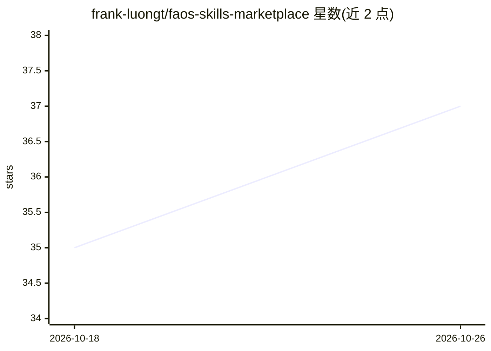

# frank-luongt/faos-skills-marketplace

⭐ 37 · TeX · Apache-2.0 · 推送 2026-07-08 · [GitHub](https://github.com/frank-luongt/faos-skills-marketplace) · [官网](https://faosx.ai/skills) · 组织维护

**面向多 AI 编码平台的 930+ 技能与 31 个 agent 插件库**

由 FAOS Framework 团队维护的开源技能库：收录 930+ 个 SKILL.md 格式技能，覆盖工程、云基础设施、产品、增长、数据 AI、安全合规等 8 大类，另含 31 个带沟通风格与 KPI 的人格化 agent 插件（C-Suite、工程、产品等分组）。技能分发到 Claude Code、OpenAI Codex、Gemini CLI、GitHub Copilot、Perplexity Computer 五个平台，各平台按对应格式（SKILL.md/TOML/instructions.md）安装。README 同时对比免费的 Marketplace 与功能更多的 FAOS Platform，后者需申请访问。Apache 2.0 许可。

## 筛选速览

| 维度 | 判定 | 备注 |
|---|---|---|
| AI 角色 | `ai-knowledge` | 知识聚合/清单类 |
| 许可风险 | `permissive` | Apache-2.0 |
| 部署形态 | `None` |  |
| 模型依赖 | — | README 未给出锁定关系 |
| 硬件要求 | — | 无带数字的原话,不猜 |
| 安装摩擦 | `low` | 无编译、无系统依赖或容器化 |
| 成熟度 | — | 结构信号不足 |

## 能力要点

- 930+ 技能按 8 大类组织（工程 280+、云 120+、产品 90+ 等）
- 31 个带人格设定与决策模式的 agent 插件
- 5 个平台格式适配：Claude Code 插件市场、Codex、Gemini CLI、Copilot、Perplexity
- Claude Code 原生插件市场一键安装与更新

## 适用场景

- 给我的 Claude Code 或 Copilot 添加代码审查、架构、安全等技能
- 为团队 AI 编码助手配置 CTO/架构师等角色插件
- 跨平台复用同一套技能文件

## 场景标签

`提示工程` `精选清单` · 领域:Agent 开发

## 证据(README 行号)

> L3: > **930+ AI-powered skills and 31 agent plugins** for Claude Code, OpenAI Codex, Gemini CLI, GitHub Copilot, and Per
> L72: ### Skills (930+) — Browse the full catalog
> L97: ### Supported Platforms

## 星数曲线

2026-10-18 35 → 2026-10-26 37（+2）

---
*卡片 v1 · prompt 1.4 · 生成 2026-10-25 · 置信度 high · 依据 README sha `92e3a60f515e` · [字段定义](../../DATASET.md)*
