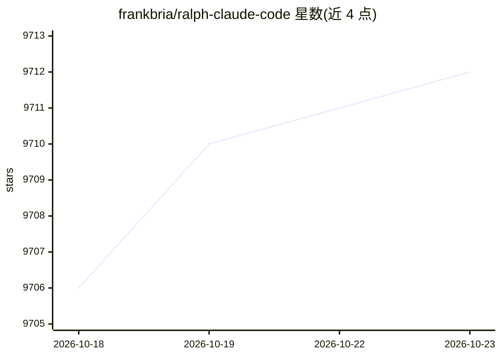

# frankbria/ralph-claude-code

⭐ 9,712 · Shell · MIT · 推送 2026-10-17 · [GitHub](https://github.com/frankbria/ralph-claude-code) · 个人维护

**让 Claude Code 持续自主迭代的开发循环驱动器**

以 Bash 脚本库形式实现 Geoffrey Huntley 的 Ralph 技巧：循环调用 Claude Code CLI，使其按项目需求/PRD/GitHub Issue 持续自主开发直至完成。关键机制包括双条件退出门（完成指标 + 显式 EXIT_SIGNAL）、每小时限速（默认 100 次可配）、熔断器与卡死检测、会话延续/过期（默认 24 小时）、Docker/E2B 沙箱执行、tmux 实时监控与 git 备份回滚。通过 git clone + install.sh 全局安装，提供 ralph-setup/enable/import/queue 等 CLI；多 provider 抽象仍在进行中。

## 筛选速览

| 维度 | 判定 | 备注 |
|---|---|---|
| AI 角色 | `ai-ecosystem` | LLM/agent 周边工具 |
| 许可风险 | `permissive` | MIT |
| 部署形态 | `self-host` | docker 或自建部署 |
| 模型依赖 | — | README 未给出锁定关系 |
| 硬件要求 | — | 无带数字的原话,不猜 |
| 安装摩擦 | `low` | 无编译、无系统依赖或容器化 |
| 成熟度 | `idea` | |

## 能力要点

- 双条件退出门 + 熔断器防止无限循环与 API 滥用
- 限速（默认 100 次/小时可配）与三层 5 小时 API 限额检测
- Docker 与 E2B 沙箱隔离执行，支持成本上限（--sandbox-max-cost）
- ralph-enable 向导自动检测项目类型并从 beads/GitHub Issues/PRD 导入任务

## 适用场景

- 让 Claude Code 在我的项目上按任务清单持续自主迭代
- 把 PRD 或 GitHub Issue 转为任务并自动推进
- 在沙箱中隔离运行自主开发循环并实时监控进度

## 场景标签

`编码 Agent` · 领域:编码与开发

## 证据(README 行号)

> L13: Ralph is an implementation of the Geoffrey Huntley's technique for Claude Code that enables continuous autonomous d
> L140: - **Autonomous Development Loop** - Continuously executes Claude Code with your project requirements
> L134: - Multi-provider agent abstraction — decoupling Ralph from `claude` so any headless coding CLI (Codex, Gemini, Ope

## 星数曲线

2026-10-18 9,706 → 2026-10-23 9,712（+6）

---
*卡片 v1 · prompt 1.4 · 生成 2026-10-20 · 置信度 mid · 依据 README sha `0fac561f313a` · [字段定义](../../DATASET.md)*
