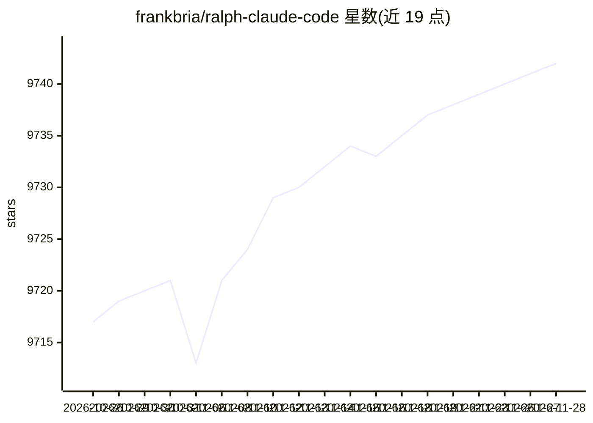

# frankbria/ralph-claude-code

⭐ 9,742 · Shell · MIT · 推送 2026-11-27 · [GitHub](https://github.com/frankbria/ralph-claude-code) · 个人维护

**为 Claude Code 提供自动循环、退出检测与限流的开发循环工具**

实现 Geoffrey Huntley 的 Ralph 技术的 bash 循环工具，让 Claude Code 迭代改进项目直至完成；内置双条件退出门（完成指标+显式 EXIT_SIGNAL）、每小时可配置的速率限制、熔断器与会话恢复等防护。提供 ralph-setup/ralph-enable/ralph-import 等命令做项目初始化与任务导入（PRD/GitHub Issues/beads），支持 Docker 与 E2B 沙箱执行。v1.x 为 bash 循环，正转向配合 Claude Code 原生 /goal 的上下文轮换插件。通过 git clone 后运行 install.sh 全局安装。

## 筛选速览

| 维度 | 判定 | 备注 |
|---|---|---|
| AI 角色 | `ai-ecosystem` | LLM/agent 周边工具 |
| 许可风险 | `permissive` | MIT |
| 部署形态 | `self-host` | docker 或自建部署 |
| 模型依赖 | — | README 未给出锁定关系 |
| 硬件要求 | — | 无带数字的原话,不猜 |
| 安装摩擦 | `low` | 无编译、无系统依赖或容器化 |
| 成熟度 | — | 结构信号不足 |

## 能力要点

- 双条件退出门：完成指标与显式 EXIT_SIGNAL 同时满足才退出
- 速率限制（默认 100 次/小时）与三层 5 小时 API 限额检测
- 支持 Docker/E2B 沙箱隔离执行与 --resume 会话延续
- 任务导入：PRD、GitHub Issues（含标签/里程碑过滤）、beads

## 适用场景

- 让 Claude Code 在我的项目里自主迭代开发直到任务完成
- 从 PRD 文档或 GitHub Issues 导入任务清单自动执行
- 担心 API 过用时用限流、熔断与干跑模式控制成本

## 场景标签

`编码 Agent` · 领域:编码与开发

## 证据(README 行号)

> L20: Ralph is an implementation of the Geoffrey Huntley's technique for Claude Code that enables continuous autonomous d
> L147: - **Autonomous Development Loop** - Continuously executes Claude Code with your project requirements

## 星数曲线

2026-10-26 9,717 → 2026-11-28 9,742（+25）

---
*卡片 v1 · prompt 1.4 · 生成 2026-11-27 · 置信度 mid · 依据 README sha `0bb476e1bfdf` · [字段定义](../../DATASET.md)*
