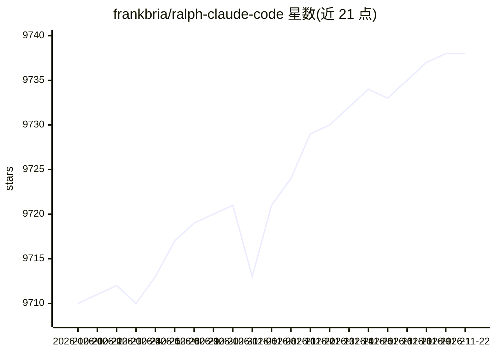

# frankbria/ralph-claude-code

⭐ 9,738 · Shell · MIT · 推送 2026-11-14 · [GitHub](https://github.com/frankbria/ralph-claude-code) · 个人维护

**给 Claude Code 加自动循环与退出检测的开发工具**

实现 Geoffrey Huntley 的 Ralph 技术的 shell 工具，围绕 Claude Code 构建自主开发循环：迭代执行任务直至完成，内置双重退出条件（完成指标 + 显式 EXIT_SIGNAL）、每小时限流（默认 100 次）、熔断器、会话续接、响应语义分析与日志轮转等防失控机制。通过 install.sh 全局安装为 ralph 等多个命令，支持 Docker/E2B 沙箱执行、tmux 监控、GitHub issue/PRD 任务导入及卸载脚本。依赖 Claude Code CLI。

## 筛选速览

| 维度 | 判定 | 备注 |
|---|---|---|
| AI 角色 | `ai-ecosystem` | LLM/agent 周边工具 |
| 许可风险 | `permissive` | MIT |
| 部署形态 | `self-host` | docker 或自建部署 |
| 模型依赖 | locked-api |  |
| 硬件要求 | — | 无带数字的原话,不猜 |
| 安装摩擦 | `low` | 无编译、无系统依赖或容器化 |
| 成熟度 | — | 结构信号不足 |

## 能力要点

- 双重条件退出门与熔断器防止无限循环
- 限流（100 次/小时可配置）与 5 小时 API 限制三层检测
- Docker 与 E2B 云沙箱隔离执行
- GitHub issue/PRD/beads 任务导入与 tmux 实时监控

## 适用场景

- 让 Claude Code 持续迭代完成项目任务清单
- 从 GitHub Issues 或 PRD 导入任务自主开发
- 用沙箱隔离运行不受控的 AI 编码循环

## 场景标签

`编码 Agent` · 领域:编码与开发

## 证据(README 行号)

> L14: Ralph is an implementation of the Geoffrey Huntley's technique for Claude Code that enables continuous autonomous d
> L141: - **Autonomous Development Loop** - Continuously executes Claude Code with your project requirements

## 星数曲线

2026-10-20 9,710 → 2026-11-22 9,738（+28）

---
*卡片 v1 · prompt 1.4 · 生成 2026-11-22 · 置信度 mid · 依据 README sha `63d0b4b20dec` · [字段定义](../../DATASET.md)*
