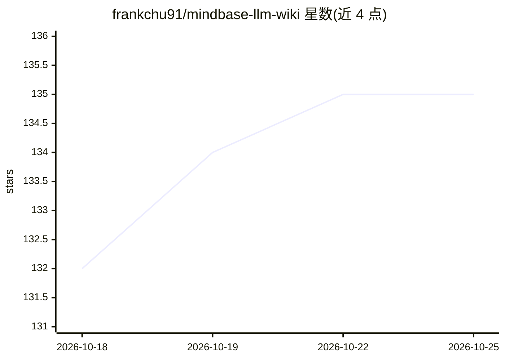

# frankchu91/mindbase-llm-wiki

⭐ 135 · TypeScript · MIT · 推送 2026-10-16 · [GitHub](https://github.com/frankchu91/mindbase-llm-wiki) · [官网](https://frankchu91.github.io/mindbase-llm-wiki/) · 个人维护

**AI 自动维护个人 Markdown 维基的知识库工具**

Karpathy LLM Wiki 想法的开源实现：用户投入论文、文章、笔记等来源，LLM 通过 ingest/build/lint 三个操作阅读、交叉引用、标记矛盾，生成并维护磁盘上的纯 Markdown 维基，查询时直接给出已合成的答案而非向量检索重推导。所有 AI 写入需人工批准。以 MCP 服务器（49 个工具）加 Web UI 形式提供，可接入 Claude Code、Cursor、Cline 等 MCP 客户端；默认配合本地 Ollama 免费模型运行，硬件检测向导按 RAM 安装合适模型，无需 API key。处于 Beta 阶段。

## 筛选速览

| 维度 | 判定 | 备注 |
|---|---|---|
| AI 角色 | `ai-native` | 本体是模型或模型工具 |
| 许可风险 | `permissive` | MIT |
| 部署形态 | `library` | 以包/库形式分发 |
| 模型依赖 | local-ok | 支持本地模型 |
| 硬件要求 | — | 无带数字的原话,不猜 |
| 安装摩擦 | `low` | 无编译、无系统依赖或容器化 |
| 成熟度 | `idea` | |

## 能力要点

- ingest/build/lint 循环：AI 读取来源、生成维基页并自审矛盾
- 所有 AI 写入经人工批准，sources 目录只追加不重写
- 49 工具 MCP 服务器，支持 Claude Code、Cursor、Windsurf、Cline、Continue 等
- 硬件检测向导按 RAM 安装 Ollama 本地模型，无需 API key

## 适用场景

- 把论文、文章、笔记沉淀为可复用的个人知识维基
- 让 AI 定期审计知识库中的矛盾与过时内容
- 在 MCP 编辑器中以工具方式操作和查询维基

## 场景标签

`知识库管理` · 领域:知识与检索

## 证据(README 行号)

> L10: > **An open-source implementation of Andrej Karpathy's LLM Wiki idea: an AI that builds and maintains a wiki from y
> L20: MindBase implements Andrej Karpathy's LLM-Wiki pattern: you feed it sources (papers, articles, thoughts); the LLM r
> L124: **Free local models:** the setup wizard detects your hardware and installs what fits — `llama3.2:3b` (8GB), `qwen3

## 星数曲线

2026-10-18 132 → 2026-10-25 135（+3）

---
*卡片 v1 · prompt 1.4 · 生成 2026-10-22 · 置信度 high · 依据 README sha `5904e1fc52bb` · [字段定义](../../DATASET.md)*
