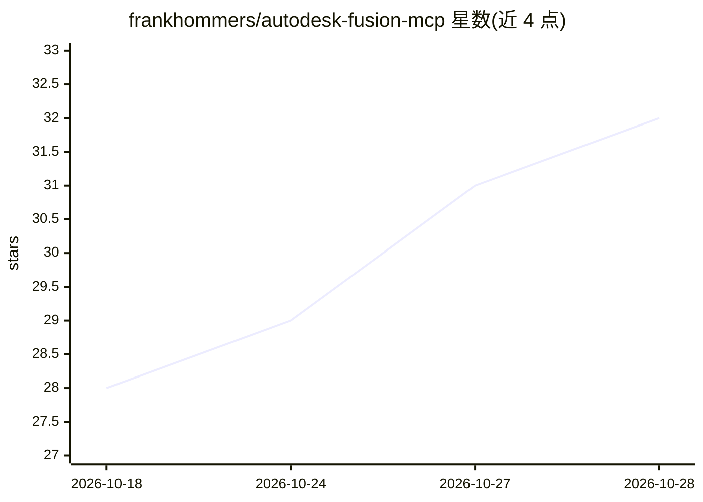

# frankhommers/autodesk-fusion-mcp

⭐ 32 · Python · MIT · 推送 2026-09-26 · [GitHub](https://github.com/frankhommers/autodesk-fusion-mcp) · 个人维护

**让 AI agent 通过 MCP 驱动 Autodesk Fusion CAD 会话的插件服务器**

以 Autodesk Fusion 插件形式运行的独立 MCP 服务器，AI agent 通过 Streamable HTTP（127.0.0.1:8765/mcp）连接并操控 CAD 会话。仅依赖 Python 标准库与 Fusion SDK，通过 Custom Event / 工作队列将 HTTP 请求转发到 Fusion 主线程。提供 14 个 MCP 工具，包括通用 Fusion API 调用、在活动会话内执行 Python、视口捕获与相机控制、选择标注的认领/完成/释放工作流，以及脚本保存加载。支持 Windows 与 macOS，安装方式为发布 zip 解压或从源码克隆到 Fusion 插件目录。

## 筛选速览

| 维度 | 判定 | 备注 |
|---|---|---|
| AI 角色 | `ai-ecosystem` | LLM/agent 周边工具 |
| 许可风险 | `permissive` | MIT |
| 部署形态 | `desktop` | 安装包/桌面程序 |
| 模型依赖 | — | README 未给出锁定关系 |
| 硬件要求 | — | 无带数字的原话,不猜 |
| 安装摩擦 | `low` | 无编译、无系统依赖或容器化 |
| 成熟度 | — | 结构信号不足 |

## 能力要点

- 原生实现 MCP Streamable HTTP 传输，保留多个旧协议版本客户端兼容
- 14 个 MCP 工具：通用 API 调用、会话内执行 Python、视口捕获与控制
- 选择标注工作流：claim/complete/release 原子认领、几何变更状态跟踪与 marker 机制
- 零外部依赖，仅用 Python 标准库与 Fusion SDK

## 适用场景

- 让 Claude Desktop、Cursor 等 MCP 客户端直接操控我的 Fusion 建模会话
- 通过自然语言让 agent 在 Fusion 中执行 Python 脚本完成自动化建模
- 用选择标注给 agent 派发 CAD 编辑任务并跟踪完成情况

## 场景标签

`工作流自动化` · 领域:效率与自动化

## 证据(README 行号)

> L3: Standalone MCP server that runs inside Autodesk Fusion (formerly Autodesk
> L4: Fusion 360) as an add-in. AI agents connect over **Streamable HTTP** -- the
> L19: - **14 dedicated MCP tools** -- each with a clean, focused schema for better

## 星数曲线

2026-10-18 28 → 2026-10-28 32（+4）

---
*卡片 v1 · prompt 1.4 · 生成 2026-10-26 · 置信度 mid · 依据 README sha `44bad43e3858` · [字段定义](../../DATASET.md)*
