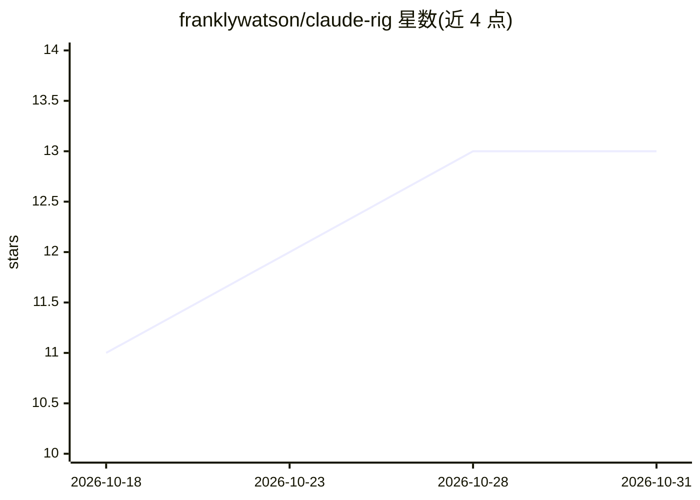

# franklywatson/claude-rig

⭐ 13 · TypeScript · MIT · 推送 2026-10-27 · [GitHub](https://github.com/franklywatson/claude-rig) · 个人维护

**把 rtk/jcodemunch/graphify 等工具接入 Claude Code 的路由与执行面板**

面向 Claude Code 项目的 TypeScript 工具链整合层：会话启动时探测已安装的 rtk、jcodemunch、graphify、Headroom、superpowers，自动索引项目并构建知识图；通过 PreToolUse/PostToolUse hooks 将 grep/find/cat 等命令改写并路由到对应工具，执行陈旧测试检查、分支纪律等约束规则；提供 brain+/plan+/tdd+ 等有序技能链（包装 superpowers 技能）、类型化子代理与 /savings 节省报告。依赖 Node.js 18+ 与 Claude Code CLI，superpowers 为必需依赖，从源码 clone 构建。

## 筛选速览

| 维度 | 判定 | 备注 |
|---|---|---|
| AI 角色 | `ai-ecosystem` | LLM/agent 周边工具 |
| 许可风险 | `permissive` | MIT |
| 部署形态 | `desktop` | 安装包/桌面程序 |
| 模型依赖 | — | README 未给出锁定关系 |
| 硬件要求 | — | 无带数字的原话,不猜 |
| 安装摩擦 | `low` | 无编译、无系统依赖或容器化 |
| 成熟度 | — | 结构信号不足 |

## 能力要点

- 会话启动即插即用探测 5 个工具，缺失时降级运行
- PreToolUse hooks 将 shell 命令透明改写并路由到 rtk/jcodemunch
- block/advise/silent 三级执行规则的 Enforcement Pipeline（.harness.yaml）
- 8 个技能链技能包装 superpowers 对应技能，verify+ 带前置门控

## 适用场景

- 在 Claude Code 中统一管理 rtk、jcodemunch 等已安装工具的路由
- 用 hooks 强制执行 TDD、分支保护等流程纪律
- 用 /savings 对比查看各层 token 节省情况

## 场景标签

 · 领域:AI 开发者工具/Agent 工具链

## 证据(README 行号)

> L7: A cockpit for your Claude Code tooling stack.
> L43: - **Tool Router** -- intercepts shell commands via PreToolUse hooks, transparently rewrites
> L53: - **Skill Chain** -- ordered workflow skills: `brain+` -> `plan+` -> `tdd+` -> `verify+` -> `review+`, plus standal

## 星数曲线

2026-10-18 11 → 2026-10-31 13（+2）

---
*卡片 v1 · prompt 1.4 · 生成 2026-10-31 · 置信度 mid · 依据 README sha `e1d4419f4231` · [字段定义](../../DATASET.md)*
