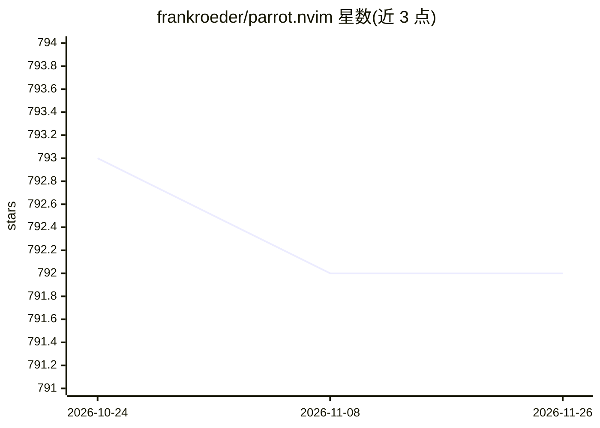

# frankroeder/parrot.nvim

⭐ 792 · Lua · NOASSERTION · 推送 2026-11-23 · [GitHub](https://github.com/frankroeder/parrot.nvim) · 个人维护

**在 Neovim 中接入多种 LLM API 的文本生成与会话插件**

以 Neovim 插件形式将多个 LLM API 集成进编辑器工作流，功能限定于文本生成：按需补全与改写（PrtRewrite/Append/Prepend）、原生 buffer 内的聊天会话、以 markdown 文件持久化对话。采用统一的 provider 系统，任何 OpenAI 兼容端点均可配置；凭据支持环境变量、Bash 命令与密码管理器 CLI。不做自主 agent 循环，也不做后台隐藏请求，可通过 ACP 协议接入 Grok Build 等 agentic 后端。要求 Neovim 0.11+，支持 lazy.nvim、Packer 与 git clone 三种安装方式。

## 筛选速览

| 维度 | 判定 | 备注 |
|---|---|---|
| AI 角色 | `ai-ecosystem` | LLM/agent 周边工具 |
| 许可风险 | `none` | NOASSERTION |
| 部署形态 | `None` |  |
| 模型依赖 | local-ok | 支持本地模型 |
| 硬件要求 | — | 无带数字的原话,不猜 |
| 安装摩擦 | `low` | 无编译、无系统依赖或容器化 |
| 成熟度 | — | 结构信号不足 |

## 能力要点

- 统一 provider 系统，支持任意 OpenAI 兼容 API 及自定义端点
- 聊天会话以 markdown 文件持久化，可用 fzf 模糊搜索
- 聊天模型与命令模型相互独立的可切换模型选择
- 凭据支持环境变量、Bash 命令与密码管理器 CLI

## 适用场景

- 在 Neovim 中对选中代码进行改写、追加或生成注释
- 在编辑器内以 markdown buffer 形式进行 LLM 聊天会话
- 通过 ollama 在本地离线环境中使用 LLM
- 将 Grok Build CLI 订阅与工具会话接入 Neovim 工作流

## 场景标签

`AI 写作` · 领域:内容生成

## 证据(README 行号)

> L11: parrot.nvim offers a seamless out-of-the-box experience, providing tight integration of current LLM APIs into your 
> L21: - Unified provider system supporting any OpenAI-compatible API:
> L15: The user is always under **full control** of what will be sent to the LLM (or agent) endpoint. Parrot does **not** 

## 星数曲线

2026-10-24 793 → 2026-11-26 792（-1）

---
*卡片 v1 · prompt 1.4 · 生成 2026-11-25 · 置信度 high · 依据 README sha `f187ff63fdf8` · [字段定义](../../DATASET.md)*
