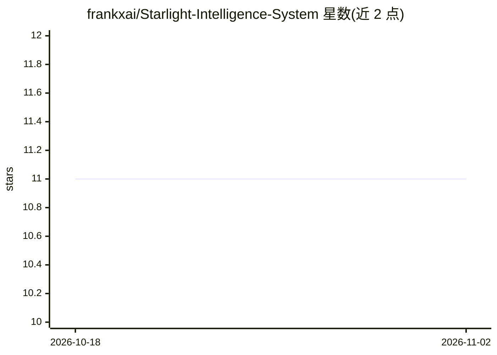

# frankxai/Starlight-Intelligence-System

⭐ 11 · TypeScript · MIT · 推送 2026-11-01 · [GitHub](https://github.com/frankxai/Starlight-Intelligence-System) · [官网](https://starlightintelligence.org/protocol) · 个人维护

**给多 AI 编程工具提供共享记忆与治理的 MCP 基座系统**

由个人主导的 AI 基座项目，分两层：SIP 开放协议（六层契约，覆盖文件规范、attestation、MCP 注册等）与 SIS 参考实现。核心机制是六个语义 JSONL vault（~/.starlight/vaults）加 SQLite FTS5 索引，通过 MCP server 暴露 13 个 sis_* 工具，让 Claude Code、Cursor、Codex、Gemini CLI 等客户端共享同一份带溯源的记忆，含时间衰减、矛盾检测与跨工具同步。另含 151 个 agent 定义、Foundry 技能编译与 Estate Factory 多 agent 编排模板。限制：模块化包为 release candidate 状态，v8.x 工作流要求 git clone 路径运行。

## 筛选速览

| 维度 | 判定 | 备注 |
|---|---|---|
| AI 角色 | `ai-ecosystem` | LLM/agent 周边工具 |
| 许可风险 | `permissive` | MIT |
| 部署形态 | `library` | 以包/库形式分发 |
| 模型依赖 | — | README 未给出锁定关系 |
| 硬件要求 | — | 无带数字的原话,不猜 |
| 安装摩擦 | `low` | 无编译、无系统依赖或容器化 |
| 成熟度 | `idea` | |

## 能力要点

- 六个语义 vault + SQLite FTS5 索引的持久共享记忆
- 生产 MCP server 暴露 13 个 sis_* 工具，适配多客户端
- SIP 六层开放协议（文件契约、attestation、MCP 注册标准等）
- Estate Factory 多 agent 编排模板与 Foundry 技能/agent 编译命令

## 适用场景

- 让 Claude Code、Cursor、Codex 等工具共享同一份持久记忆，避免重复说明
- 为 agent 队伍建立带 attestation 溯源的知识库
- 采用或 fork SIP 协议构建自己的主权智能系统

## 场景标签

`Agent 记忆` `多智能体` · 领域:Agent 开发

## 证据(README 行号)

> L41: Starlight Intelligence System (SIS) is the **sovereign AI substrate** for memory, orchestration, skills, governance
> L185: MCP Server — 13 sis_* tools exposed uniformly to every platform adapter.

## 星数曲线

2026-10-18 11 → 2026-11-02 11（+0）

---
*卡片 v1 · prompt 1.4 · 生成 2026-11-02 · 置信度 high · 依据 README sha `30d1bb389605` · [字段定义](../../DATASET.md)*
