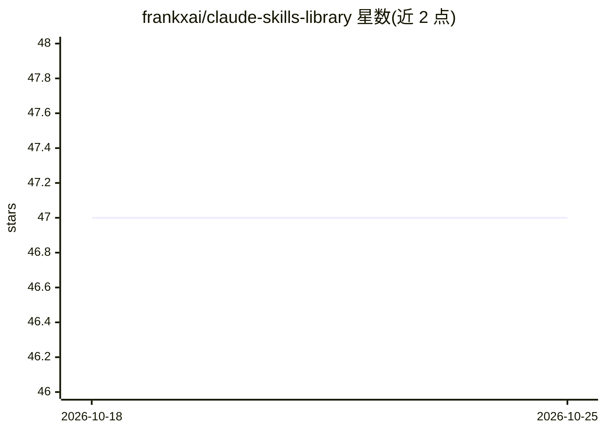

# frankxai/claude-skills-library

⭐ 47 · Python · MIT · 推送 2026-10-24 · [GitHub](https://github.com/frankxai/claude-skills-library) · [官网](https://frankx.ai/products/agentic-creator-os?utm_source=github&utm_medium=repo&utm_campaign=claude-skills-library) · 个人维护

**面向 Claude Code 等 6 种运行时的 114 条 Agent 技能库与 7 个强制包**

由 FrankX 维护的 Agent Skills 公共库：收录 114 个自包含 SKILL.md 技能文件夹，覆盖 AI 编排、MCP、前端、代码评审、创作生产等 11 类，可在 Claude Code、OpenCode、Codex CLI、Gemini CLI 等 6 种技能感知运行时使用；另有 7 个强制包，通过 hooks、CI 脚本等方式把技能约束变成默认门槛。README 自述局限：尚无 evals 证据，且 Anthropic 参考技能未附 commit pin。安装方式为 Claude Code 插件市场、npx skills 命令或 git clone 复制。

## 筛选速览

| 维度 | 判定 | 备注 |
|---|---|---|
| AI 角色 | `ai-knowledge` | 知识聚合/清单类 |
| 许可风险 | `permissive` | MIT |
| 部署形态 | `library` | 以包/库形式分发 |
| 模型依赖 | — | README 未给出锁定关系 |
| 硬件要求 | — | 无带数字的原话,不猜 |
| 安装摩擦 | `low` | 无编译、无系统依赖或容器化 |
| 成熟度 | `idea` | |

## 能力要点

- 114 个 SKILL.md 技能，frontmatter 经 CI 校验，11 类目录
- 7 个强制包：hooks 拦截、CI 漂移检查、fail-closed 分类器
- 第三方技能 pin 到上游 commit，README 计数在 CI 中与目录树核对
- 提供 6 种运行时（Claude Code/OpenCode/Codex CLI/Gemini CLI 等）适配指南

## 适用场景

- 为 Claude Code 等 coding agent 按需安装领域技能
- 在 CI 中用强制包拦截缺少审计证据的完成声明
- 给 agent 增加 MCP 架构设计、代码评审等专家知识

## 场景标签

`提示工程` `精选清单` · 领域:Agent 开发

## 证据(README 行号)

> L5: ### 114 Agent Skills for every skills-aware runtime, and 7 enforcement packs for Claude Code
> L66: |**Skills**|114 self-contained `SKILL.md` folders. Spec-validated frontmatter, trigger-rich descriptions, deep guid
> L183: ## Works with six runtimes

## 星数曲线

2026-10-18 47 → 2026-10-25 47（+0）

---
*卡片 v1 · prompt 1.4 · 生成 2026-10-25 · 置信度 high · 依据 README sha `866e6fe32ae2` · [字段定义](../../DATASET.md)*
