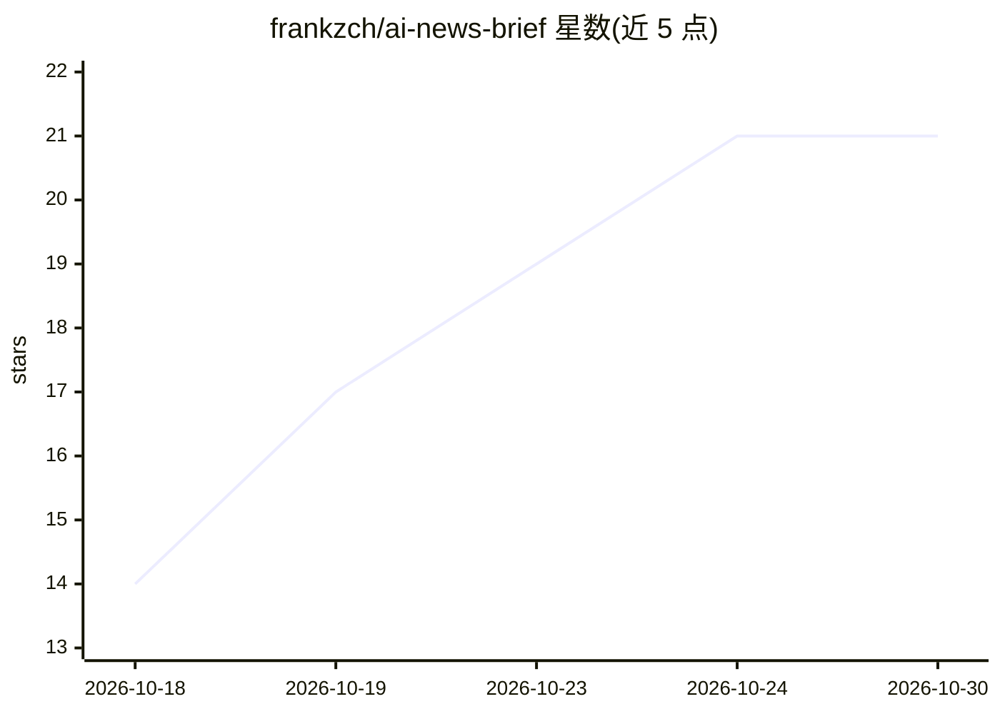

# frankzch/ai-news-brief

⭐ 21 · Python · MIT · 推送 2026-10-12 · [GitHub](https://github.com/frankzch/ai-news-brief) · [官网](https://inbrief.info) · 个人维护 · 中文 README

**自托管的 AI 新闻聚合引擎：370+ 来源生成中英双语日报**

开源、可自托管的 AI 新闻聚合管道：从 RSS、Hacker News、Reddit、X（约 310 个 AI 账号）、YouTube 字幕与 GitHub Trending 等 370+ 来源抓取内容，经 LLM 流水线做相关性过滤、双语（中英）摘要、标签抽取与重要性打分，再用 SimHash + pgvector 两阶段去重后存入 PostgreSQL。要求 Python 3.10+、启用 pgvector 的 PostgreSQL 和任一 OpenAI 兼容 API（默认 DeepSeek）。Reddit/X/YouTube 抓取依赖 Playwright 驱动的 Chromium，首跑可能需登录。它是 inbrief.info 背后的引擎，也可用 agent skill 直接查询托管版而无需自建。

## 筛选速览

| 维度 | 判定 | 备注 |
|---|---|---|
| AI 角色 | `ai-native` | 本体是模型或模型工具 |
| 许可风险 | `permissive` | MIT |
| 部署形态 | `library` | 以包/库形式分发 |
| 模型依赖 | — | README 未给出锁定关系 |
| 硬件要求 | — | 无带数字的原话,不猜 |
| 安装摩擦 | `low` | 无编译、无系统依赖或容器化 |
| 成熟度 | — | 结构信号不足 |

## 能力要点

- 370+ 来源抓取（RSS/HN/Reddit/X/YouTube/GitHub Trending）
- LLM 过滤 + 中英双语摘要 + 标签 + 重要性打分
- SimHash 快筛 + pgvector 语义余弦的两阶段去重
- curl_cffi TLS 伪装 → DrissionPage 真浏览器 → httpx 分层反爬

## 适用场景

- 自建一个每天自动汇总 AI 资讯的双语日报
- 把多平台 AI 讨论去重合并后统一阅读
- 通过 Claude Code 等 agent 的 skill 查询托管版摘要

## 场景标签

`网页抓取` · 领域:效率与自动化

## 证据(README 行号)

> L5: An open-source, self-hostable **AI news aggregator** that turns 370+ sources — AI lab blogs, Hacker News, Reddit, ~3
> L9: It continuously pulls AI-related content from RSS feeds, Hacker News, Reddit, X (Twitter), YouTube and GitHub Trendi
> L15:             └─ ai_engine     (LLM: filter / summarize / tag / score)

## 星数曲线

2026-10-18 14 → 2026-10-30 21（+7）

---
*卡片 v1 · prompt 1.4 · 生成 2026-10-28 · 置信度 high · 依据 README sha `c79cb1ed8988` · [字段定义](../../DATASET.md)*
