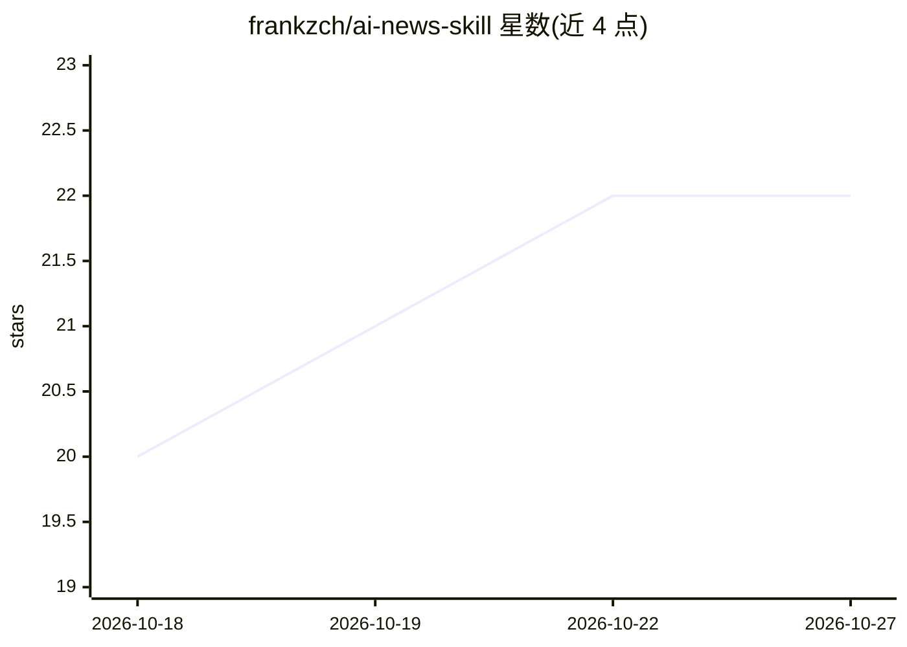

# frankzch/ai-news-skill

⭐ 22 · Python · MIT · 推送 2026-10-12 · [GitHub](https://github.com/frankzch/ai-news-skill) · [官网](https://inbrief.info) · 个人维护 · 中文 README

**让编码 agent 用自然语言获取每日 AI 新闻摘要的技能**

面向 Claude Code、Codex、OpenClaw 与 Antigravity 的 Agent Skill：用户以自然语言提问即可获得来自 370+ 策展来源的去重摘要，包括 16 个新闻源、Hacker News 与 16 个 Reddit 源、约 310 位 X 上的 AI 从业者、13 个 YouTube 频道、Hugging Face 论文与 GitHub Trending，来源每 2 小时刷新。数据处理由 InBrief.info 免费提供，无 API key 时每次请求上限 3 条，登录 6 条，会员 100 条。安装只需一次 git clone 到各 agent 的技能目录，支持中英文摘要输出。

## 筛选速览

| 维度 | 判定 | 备注 |
|---|---|---|
| AI 角色 | `ai-ecosystem` | LLM/agent 周边工具 |
| 许可风险 | `permissive` | MIT |
| 部署形态 | `None` |  |
| 模型依赖 | locked-api |  |
| 硬件要求 | — | 无带数字的原话,不猜 |
| 安装摩擦 | `low` | 无编译、无系统依赖或容器化 |
| 成熟度 | — | 结构信号不足 |

## 能力要点

- 370+ 策展来源，含约 310 位 X 上的 AI 从业者与 13 个 YouTube 频道
- 来源每 2 小时自动刷新
- 通过自然语言控制类别/来源/时间范围/摘要长度等过滤条件
- 结果可打印到终端或导出 JSON，摘要支持中英文

## 适用场景

- 在 Claude Code/Codex 里直接问今天的 AI 新闻并获取摘要
- 不刷 X 也能跟踪约 310 位 AI 从业者的高互动帖子
- 按类别和来源过滤订阅 AI 资讯并导出 JSON

## 场景标签

 · 领域:AI 资讯聚合/agent 工具

## 证据(README 行号)

> L10: Ask your coding agent *"what happened in AI today?"* and get a deduplicated, summarized digest from **370+ curated 
> L16: Works with Claude Code, Codex, OpenClaw and Antigravity (see Quick Start for paths).
> L47: Install this skill into your AI agent (supports OpenClaw, Claude Code, Antigravity, Codex)

## 星数曲线

2026-10-18 20 → 2026-10-27 22（+2）

---
*卡片 v1 · prompt 1.4 · 生成 2026-10-27 · 置信度 high · 依据 README sha `fd591a4e1274` · [字段定义](../../DATASET.md)*
