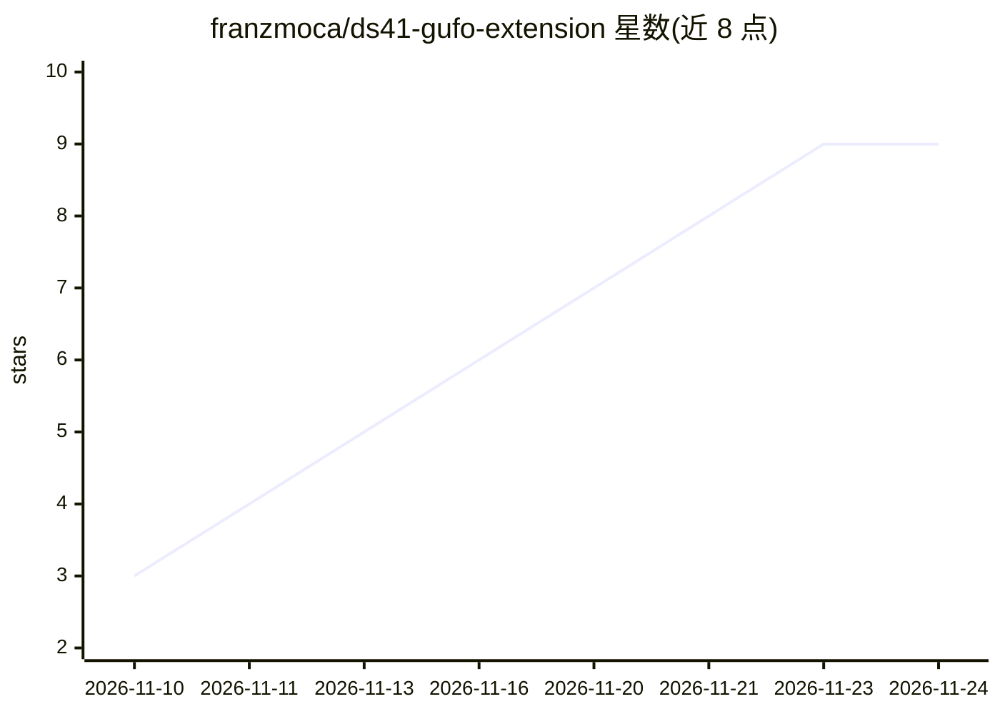

# franzmoca/ds41-gufo-extension

⭐ 9 · C++ · MIT · 推送 2026-11-23 · [GitHub](https://github.com/franzmoca/ds41-gufo-extension) · 个人维护

**在单台 AMD Strix Halo 上运行 DeepSeek V4.1 Flash 的 Gufo 扩展**

作为 Gufo 源码扩展构建，将 763B 参数 MoE 模型 DeepSeek-V4.1-Flash-1017（原生 1M 上下文）运行在 128 GB 统一内存的单台 AMD Strix Halo 上：小量化构建常驻内存，更大的构建保留稠密权重常驻、从 SSD 流式读取路由专家。提供 DSpark 投机解码、OpenAI 兼容服务器（推理、工具调用、图像输入、并发会话）、RAM/磁盘提示缓存，以及从 SSD 读取的 Engram n-gram 表。默认占用整机内存，需用参数限制专家缓存以共享机器。

## 筛选速览

| 维度 | 判定 | 备注 |
|---|---|---|
| AI 角色 | `ai-ecosystem` | LLM/agent 周边工具 |
| 许可风险 | `permissive` | MIT |
| 部署形态 | `desktop` | 安装包/桌面程序 |
| 模型依赖 | locked-api |  |
| 硬件要求 | — | 无带数字的原话,不猜 |
| 安装摩擦 | `medium` | 含编译或系统依赖之一 |
| 成熟度 | — | 结构信号不足 |

## 能力要点

- 多种 GGUF 量化构建，支持常驻或 SSD 专家流式两种运行方式
- DSpark 投机解码与 prompt lookup，greedy 输出与普通解码一致
- OpenAI 兼容服务器：推理、原生工具调用、图像输入、并发会话与提示缓存
- 可运行时加载 LoRA 与方向适配器

## 适用场景

- 在单台 128 GB Strix Halo 机器上本地运行 763B MoE 模型
- 通过 OpenAI 兼容 API 提供本地推理与工具调用服务
- 用小专家缓存与其他工作负载共享同一台机器

## 场景标签

`推理引擎` · 领域:训练与推理

## 证据(README 行号)

> L4: native 1M-token context, on a single AMD Strix Halo with 128 GB of unified memory.
> L6: This is a Gufo source extension: it builds into
> L14: - **A complete server.** Gufo's OpenAI-compatible text API with reasoning, native

## 星数曲线

2026-11-10 3 → 2026-11-24 9（+6）

---
*卡片 v1 · prompt 1.4 · 生成 2026-11-20 · 置信度 high · 依据 README sha `d9ec970641c2` · [字段定义](../../DATASET.md)*
