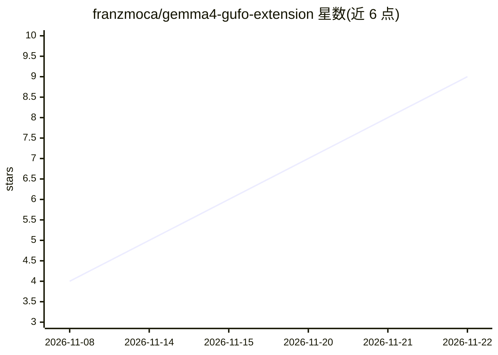

# franzmoca/gemma4-gufo-extension

⭐ 9 · C++ · MIT · 推送 2026-11-21 · [GitHub](https://github.com/franzmoca/gemma4-gufo-extension) · 个人维护

**为 Gufo 推理框架提供 Gemma 4 模型支持的源码扩展**

Gufo 推理运行时的源码扩展，接入 Google Gemma 4 系列（31B、31B QAT、26B-A4B MoE）GGUF 模型，面向 Linux x86-64 与 Strix Halo gfx1151 平台。支持 MTP 投机解码草稿、prompt lookup、BF16 视觉 sidecar、批量会话、原生工具调用与共享缓存，并暴露推理预算、草稿校准等服务端参数。需与 Gufo v0.35.0（扩展 API 0.3.20+）一同构建，README 记录了多版本测试通过情况与已知失败项。

## 筛选速览

| 维度 | 判定 | 备注 |
|---|---|---|
| AI 角色 | `ai-ecosystem` | LLM/agent 周边工具 |
| 许可风险 | `permissive` | MIT |
| 部署形态 | `None` |  |
| 模型依赖 | — | README 未给出锁定关系 |
| 硬件要求 | — | 无带数字的原话,不猜 |
| 安装摩擦 | `medium` | 含编译或系统依赖之一 |
| 成熟度 | — | 结构信号不足 |

## 能力要点

- 支持 Gemma 4 31B/31B QAT/26B-A4B 的多种 GGUF 量化格式
- 提供 MTP 投机解码草稿（最多 15 tokens）、prompt lookup 与 BF16 视觉 sidecar
- 通过 gufo serve llm 暴露推理内容、原生工具调用、图像输入与提示缓存端点
- 随附 Nix flake，可按固定 Gufo 版本一体构建

## 适用场景

- 在 Strix Halo（gfx1151）本地运行 Gemma 4 系列模型推理
- 通过 Gufo 服务器提供带工具调用与图像输入的文本服务
- 对 Gemma 4 模型做基准测试与质量验证

## 场景标签

`推理引擎` · 领域:训练与推理

## 证据(README 行号)

> L3: A Gufo source extension for Google's
> L103: The extension needs extension API 0.3.20 or later (Gufo v0.35.0, which

## 星数曲线

2026-11-08 4 → 2026-11-22 9（+5）

---
*卡片 v1 · prompt 1.4 · 生成 2026-11-20 · 置信度 high · 依据 README sha `af841cd7df1a` · [字段定义](../../DATASET.md)*
