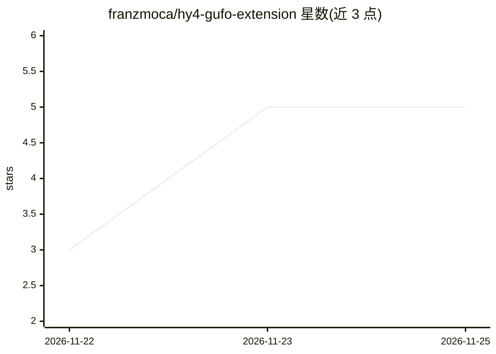

# franzmoca/hy4-gufo-extension

⭐ 5 · C++ · MIT · 推送 2026-11-23 · [GitHub](https://github.com/franzmoca/hy4-gufo-extension) · 个人维护

**在 AMD Strix Halo 上本地运行腾讯 Hy4 Flash 模型的 Gufo 扩展**

面向 Gufo 运行时的模型源扩展，使 Gufo 能通过 `gufo serve llm` 加载并运行 Tencent Hy4 Flash 模型（GGUF 格式），目标平台为 Linux x86-64 与 AMD Strix Halo gfx1151。支持聊天、工具调用、推理、图像输入、RAM/磁盘提示缓存，可选用 Tencent DFly2 做投机解码。README 标注状态为 experimental，给出 Nix 与 CMake 两种构建方式、模型文件布局与上下文/图像 token 计算说明，性能数据指向 docs/ 下文档。

## 筛选速览

| 维度 | 判定 | 备注 |
|---|---|---|
| AI 角色 | `ai-native` | 本体是模型或模型工具 |
| 许可风险 | `permissive` | MIT |
| 部署形态 | `None` |  |
| 模型依赖 | — | README 未给出锁定关系 |
| 硬件要求 | — | 无带数字的原话,不猜 |
| 安装摩擦 | `medium` | 含编译或系统依赖之一 |
| 成熟度 | `idea` | |

## 能力要点

- 以 GGUF 格式加载 Hy4 Flash（含 Engram 分片与 mmproj 视觉塔文件）
- 可选 DFly2 投机解码，可配置草稿 token 数与接受阈值
- 支持图像输入、提示缓存（RAM 与磁盘）、工具调用
- Nix 构建或 CMake 从 Gufo 源码检出构建两种方式

## 适用场景

- 在 Strix Halo 设备上本地运行 Hy4 Flash 大模型
- 通过 gufo serve llm 提供带图像输入的聊天服务
- 用 DFly2 投机解码加速本地解码吞吐

## 场景标签

`推理引擎` · 领域:训练与推理

## 证据(README 行号)

> L3: An experimental Gufo source extension for Tencent's
> L7: **Status:** experimental. `gufo serve llm` serves chat, tool calls, reasoning,
> L44: gufo serve llm -m Hy4-flash-Q4_K_M-00001-of-00002.gguf \

## 星数曲线

2026-11-22 3 → 2026-11-25 5（+2）

---
*卡片 v1 · prompt 1.4 · 生成 2026-11-22 · 置信度 high · 依据 README sha `b963bbf0c32a` · [字段定义](../../DATASET.md)*
