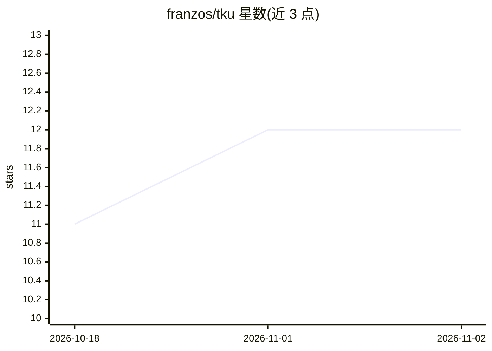

# franzos/tku

⭐ 12 · Rust · GPL-3.0 · 推送 2026-11-01 · [GitHub](https://github.com/franzos/tku) · 个人维护

**本地 CLI：统计 Claude Code 等 AI 编码代理的用量与花费**

Rust 编写的本地优先 CLI，扫描本地会话文件并获取实时定价，为 Claude Code、Codex、Gemini CLI 等 AI 编码代理提供 token 用量与美元成本的聚合报告：按日/月/会话/模型统计、燃烧速率、实时花费监控（watch）、内联图表、Claude Max/Pro 订阅用量概览与升降级建议、多账户切换（account add/use/exec）及会话文件密钥擦除。订阅概览需 Claude Code OAuth 登录，目前仅支持 Claude 账户。

## 筛选速览

| 维度 | 判定 | 备注 |
|---|---|---|
| AI 角色 | `ai-ecosystem` | LLM/agent 周边工具 |
| 许可风险 | `viral` | GPL-3.0 |
| 部署形态 | `desktop` | 安装包/桌面程序 |
| 模型依赖 | — | README 未给出锁定关系 |
| 硬件要求 | — | 无带数字的原话,不猜 |
| 安装摩擦 | `medium` | 含编译或系统依赖之一 |
| 成熟度 | — | 结构信号不足 |

## 能力要点

- 扫描本地会话文件并获取实时定价（litellm/openrouter/llmprices 三种定价源）计算美元成本
- watch 实时花费监控（基于 inotify/FSEvents/kqueue 文件变更刷新）
- Claude Max/Pro 订阅用量概览与升降级建议（--plan）
- 多 Claude 账户暂存与切换（account add/use/exec，隔离单次会话运行）

## 适用场景

- 查看我各 AI 编码工具的 token 用量与真实美元花费
- 实时监控今日花费避免超预算
- 管理并按需切换个人与工作多个 Claude 账户
- 决定 Claude 订阅该升级还是降级

## 场景标签

`LLM 可观测性` · 领域:评测与运维

## 证据(README 行号)

> L3: A local-first CLI for Claude Code, Codex and other AI coding agents: token usage, real dollar cost (live pricing), s
> L41: |`watch`|Live-updating cost monitor (default: compact single line, today only)|

## 星数曲线

2026-10-18 11 → 2026-11-02 12（+1）

---
*卡片 v1 · prompt 1.4 · 生成 2026-11-01 · 置信度 high · 依据 README sha `50dec8e4c802` · [字段定义](../../DATASET.md)*
