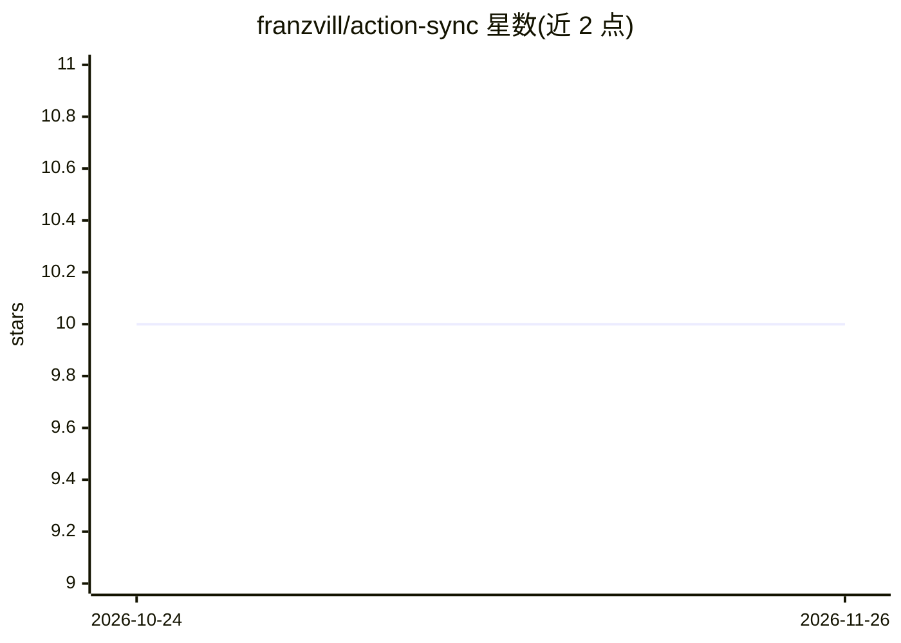

# franzvill/action-sync

⭐ 10 · Python · MIT · 推送 2026-03-22 · [GitHub](https://github.com/franzvill/action-sync) · 个人维护

**把会议记录转为 Jira 工单的开发团队工具**

基于 FastAPI + Vanilla JS SPA 的自托管 Web 应用，提供三种模式：Meeting 模式粘贴会议转录后由 Claude 结合 GitLab 仓库上下文创建含文件、组件与验收标准的 Jira 工单；Ask 模式跨 Jira 工单、历史会议与代码库回答项目问题；Work 模式让 Claude 克隆仓库读取工单并进行实现。通过 WebSocket 提供实时进度，支持向量嵌入语义搜索会议历史，需接入 Jira API token，GitLab 与嵌入功能可选。

## 筛选速览

| 维度 | 判定 | 备注 |
|---|---|---|
| AI 角色 | `ai-native` | 本体是模型或模型工具 |
| 许可风险 | `permissive` | MIT |
| 部署形态 | `self-host` | docker 或自建部署 |
| 模型依赖 | locked-api |  |
| 硬件要求 | — | 无带数字的原话,不猜 |
| 安装摩擦 | `low` | 无编译、无系统依赖或容器化 |
| 成熟度 | — | 结构信号不足 |

## 能力要点

- Meeting/Ask/Work 三种模式：生成工单、项目问答、自主实现工单
- GitLab 仓库克隆提供代码上下文（可选）
- 会议历史向量嵌入语义搜索（OpenAI/Azure 嵌入，可选）
- 支持直连 Anthropic API 或 Azure Anthropic 两种 LLM 通道

## 适用场景

- 会议后自动把讨论内容生成带技术细节的 Jira 工单
- 用自然语言询问项目相关的工单、会议与代码信息
- 让 AI 读取指定 Jira 工单并克隆仓库着手实现

## 场景标签

`编码 Agent` `AI 助手` · 领域:编码与开发

## 证据(README 行号)

> L3: Transform meeting transcriptions into Jira tickets automatically using Claude AI.
> L11: - **Meeting Mode**: Paste a meeting transcript. Claude analyzes it, checks your GitLab repos for technical context,
> L29: - **Backend**: FastAPI with async SQLAlchemy (PostgreSQL/SQLite)

## 星数曲线

2026-10-24 10 → 2026-11-26 10（+0）

---
*卡片 v1 · prompt 1.4 · 生成 2026-11-19 · 置信度 high · 依据 README sha `a7a3074802c3` · [字段定义](../../DATASET.md)*
