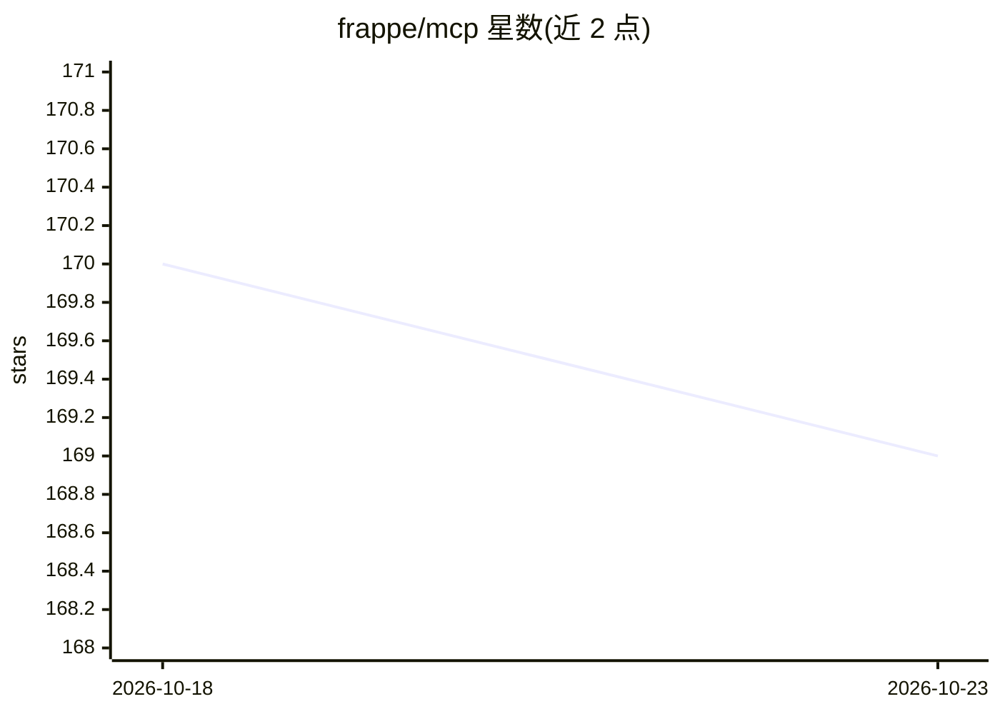

# frappe/mcp

⭐ 169 · Python · MIT · 推送 2026-05-29 · [GitHub](https://github.com/frappe/mcp) · 组织维护

**让 Frappe 应用作为 MCP 服务器的库，供 LLM 调用工具**

面向 Frappe Framework 开发者的 MCP 服务器实现库。因官方 Python SDK 仅支持 ASGI，而 Frappe 基于 WSGI（Werkzeug），本项目从头实现了 Streamable HTTP 传输，使 Frappe 应用能暴露 MCP 端点供 LLM 客户端调用。提供 @mcp.tool 装饰器与 add_tool 方法注册工具，自动从 docstring 与类型注解生成 inputSchema，支持 OAuth2 认证、ToolAnnotations 与 allow_guest 选项，另附 CLI 检查命令。当前处于实验早期，仅支持 Tools，resources/prompts/SSE 流式暂缺。

## 筛选速览

| 维度 | 判定 | 备注 |
|---|---|---|
| AI 角色 | `ai-ecosystem` | LLM/agent 周边工具 |
| 许可风险 | `permissive` | MIT |
| 部署形态 | `library` | 以包/库形式分发 |
| 模型依赖 | — | README 未给出锁定关系 |
| 硬件要求 | — | 无带数字的原话,不猜 |
| 安装摩擦 | `low` | 无编译、无系统依赖或容器化 |
| 成熟度 | `idea` | |

## 能力要点

- 为 WSGI（Werkzeug）环境从零实现的 Streamable HTTP MCP 服务器
- @mcp.tool 装饰器与 mcp.add_tool 方法注册工具，自动生成 inputSchema
- mcp.handle 可用于任何基于 Werkzeug 的应用，不限于 Frappe
- CLI check 命令校验 MCP 服务器配置正确性

## 适用场景

- 把 Frappe 应用的业务函数暴露为 MCP 工具供 LLM 客户端调用
- 在基于 Werkzeug 的非 Frappe 服务中托管 MCP 端点
- 用官方 Inspector 工具配合 OAuth2 测试 MCP 服务

## 场景标签

`Agent 框架` · 领域:Agent 开发

## 证据(README 行号)

> L3: Frappe MCP allows your Frappe Framework app to function as a [Streamable HTTP MCP
> L271: This method can be used to integrate the MCP server into **any Werkzeug-based application**

## 星数曲线

2026-10-18 170 → 2026-10-23 169（-1）

---
*卡片 v1 · prompt 1.4 · 生成 2026-10-23 · 置信度 high · 依据 README sha `ee70a3226520` · [字段定义](../../DATASET.md)*
