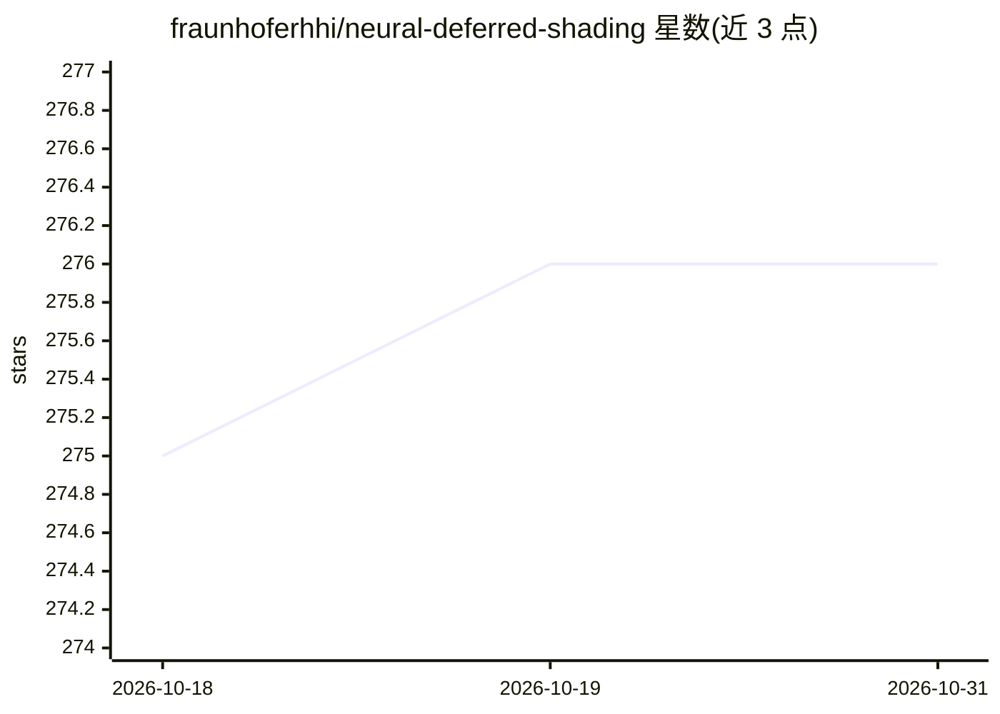

# fraunhoferhhi/neural-deferred-shading

⭐ 276 · Python · NOASSERTION · 推送 2026-07-13 · [GitHub](https://github.com/fraunhoferhhi/neural-deferred-shading) · 组织维护

**CVPR 2022 论文官方代码：可微网格渲染+神经着色的多视角三维重建**

Fraunhofer HHI 发布的 CVPR 2022 论文官方 PyTorch 实现：基于可微网格渲染与神经着色（neural shading）从多视角 RGB(A) 图像与相机参数快速重建物体网格。输入为视图文件夹（含 OpenCV 格式内外参）、场景包围盒，可选初始网格；输出网格与学习到的着色器，附带 OpenGL 交互查看器与性能分析分支。提供 DTU 数据集示例、IDR 格式转换脚本；实验使用 24 GB GPU，显存不足时需降低输入分辨率。

## 筛选速览

| 维度 | 判定 | 备注 |
|---|---|---|
| AI 角色 | `ai-native` | 本体是模型或模型工具 |
| 许可风险 | `none` | NOASSERTION |
| 部署形态 | `library` | 以包/库形式分发 |
| 模型依赖 | — | README 未给出锁定关系 |
| 硬件要求 | — | 无带数字的原话,不猜 |
| 安装摩擦 | `medium` | 含编译或系统依赖之一 |
| 成熟度 | — | 结构信号不足 |

## 能力要点

- 可微网格渲染 + 神经着色的多视角重建管线
- 支持自定义场景输入（视图 + 相机内外参 + 包围盒 + 可选初始网格）
- OpenGL 交互查看器检查重建网格与学习到的外观
- 提供 DTU 数据集示例与 IDR→NDS 格式转换脚本

## 适用场景

- 我想从多视角照片重建物体的三维网格
- 我想复现或对比 CVPR 2022 的神经延迟着色重建方法
- 我想检查重建网格及其学习到的外观（交互查看器）

## 场景标签

`图像视频处理` · 领域:感知与多模态

## 证据(README 行号)

> L23: Official code for the CVPR 2022 paper "Multi-View Mesh Reconstruction with N eural D eferred S hading", a method fo
> L30: pip install -r requirements.txt

## 星数曲线

2026-10-18 275 → 2026-10-31 276（+1）

---
*卡片 v1 · prompt 1.4 · 生成 2026-10-22 · 置信度 high · 依据 README sha `48f57d18afbc` · [字段定义](../../DATASET.md)*
