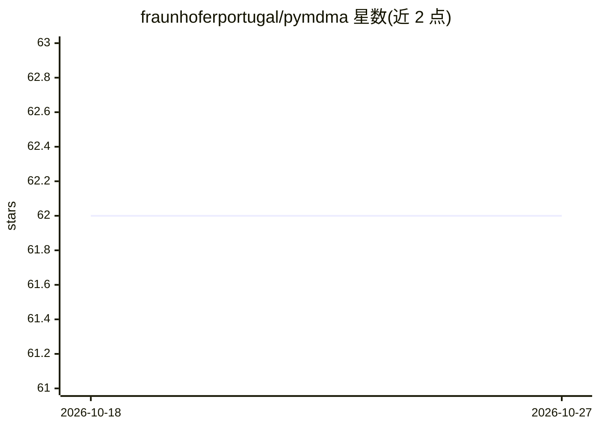

# fraunhoferportugal/pymdma

⭐ 62 · Python · LGPL-3.0 · 推送 2026-10-07 · [GitHub](https://github.com/fraunhoferportugal/pymdma) · 组织维护

**多模态数据集审计库：评估真实与合成数据的质量**

面向研究人员、从业者与开发者的数据审计 Python 库，提供覆盖图像、表格、时间序列三种模态的指标套件，用于合成数据评估（如 Improved Precision/Recall）与输入数据质量评估（如清晰度）。支持按模态安装可选依赖，提供 Python API 导入指标与 CLI 命令行两种使用方式，评估结果以 JSON 报告输出。可强制安装 CPU 版 torch 做无 CUDA 的最小安装。由 Fraunhofer Portugal 开源，LGPL-3.0 许可，发表于 SoftwareX 期刊。

## 筛选速览

| 维度 | 判定 | 备注 |
|---|---|---|
| AI 角色 | `ai-ecosystem` | LLM/agent 周边工具 |
| 许可风险 | `viral` | LGPL-3.0 |
| 部署形态 | `library` | 以包/库形式分发 |
| 模型依赖 | — | README 未给出锁定关系 |
| 硬件要求 | — | 无带数字的原话,不猜 |
| 安装摩擦 | `medium` | 含编译或系统依赖之一 |
| 成熟度 | — | 结构信号不足 |

## 能力要点

- 覆盖图像、表格、时间序列三种模态的审计指标
- 合成数据评估指标（如 Improved Precision/Recall）与输入数据质量指标
- 提供 Python API 与 pymdma CLI 两种使用方式，报告以 JSON 输出
- 可按模态安装可选依赖，支持无 CUDA 的 CPU 最小安装

## 适用场景

- 评估合成数据集相对真实参考集的保真度
- 对输入数据集做质量与可用性审计
- 在 ML 流程中按模态导入指标做数据质量检查

## 场景标签

 · 领域:数据科学/机器学习评估

## 证据(README 行号)

> L17: Existing repositories often lack comprehensive coverage across various modalities or validation types. This work in
> L19: This library aims to serve as a unified and accessible resource for researchers, practitioners, and developers, ena

## 星数曲线

2026-10-18 62 → 2026-10-27 62（+0）

---
*卡片 v1 · prompt 1.4 · 生成 2026-10-24 · 置信度 high · 依据 README sha `758e28bde389` · [字段定义](../../DATASET.md)*
