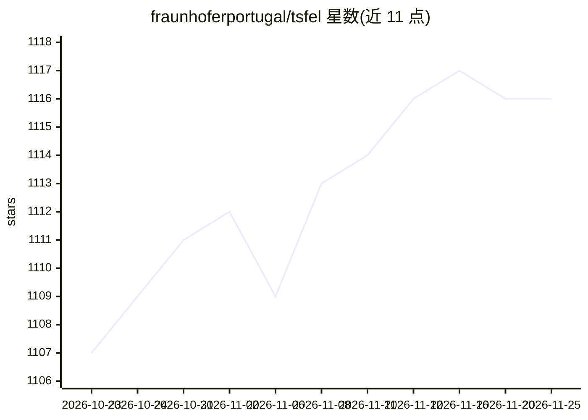

# fraunhoferportugal/tsfel

⭐ 1,116 · Python · BSD-3-Clause · 推送 2026-11-23 · [GitHub](https://github.com/fraunhoferportugal/tsfel) · [官网](https://tsfel.readthedocs.io) · 组织维护

**时序特征提取 Python 库：统计/时域/频谱/分域 65+ 特征**

开源 Python 库，集中提供统计、时域、频谱与分形四个领域的 65+ 时序特征提取方法，用于分类、回归与信号处理任务。通过配置文件定义提取流水线以实现可复现，支持预先估算特征提取的计算耗时，每个特征附带说明文档与单元测试，支持添加自定义特征。经 pip 安装，要求 Python 3.11 以上，conda-forge 发布尚未上线。配套速查表 PDF、Colab 示例与 Slack 社区。

## 筛选速览

| 维度 | 判定 | 备注 |
|---|---|---|
| AI 角色 | `ai-native` | 本体是模型或模型工具 |
| 许可风险 | `permissive` | BSD-3-Clause |
| 部署形态 | `library` | 以包/库形式分发 |
| 模型依赖 | — | README 未给出锁定关系 |
| 硬件要求 | — | 无带数字的原话,不猜 |
| 安装摩擦 | `low` | 无编译、无系统依赖或容器化 |
| 成熟度 | — | 结构信号不足 |

## 能力要点

- 统计/时域/频谱/分形四域 65+ 特征，配置文件保证可复现
- 支持预先估算特征提取的计算时间
- 每个特征有详细文档说明与单元测试
- 支持社区贡献自定义特征扩展

## 适用场景

- 为可穿戴传感器数据（ECG/EEG/EMG）提取特征做活动识别
- 为时序分类/回归模型构建特征工程流水线
- 音频与生物信号处理研究中的特征提取

## 场景标签

`科研工具` · 领域:学习与行业

## 证据(README 行号)

> L18: `TSFEL` is an open-source Python library for time series analysis. It centralizes a large and powerful feature set 
> L68: `TSFEL` automatically extracts more than 65 distinct features across statistical, temporal, spectral, and fractal

## 星数曲线

2026-10-23 1,107 → 2026-11-25 1,116（+9）

---
*卡片 v1 · prompt 1.4 · 生成 2026-11-24 · 置信度 high · 依据 README sha `f98896a0d5ae` · [字段定义](../../DATASET.md)*
