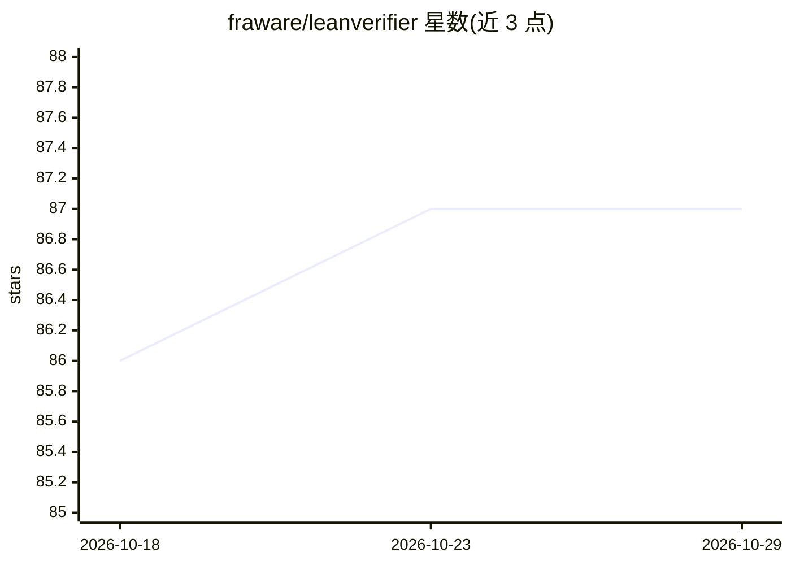

# fraware/leanverifier

⭐ 87 · Python · MIT · 推送 2026-07-26 · [GitHub](https://github.com/fraware/leanverifier) · 个人维护

**用 Lean 4 形式化验证仿射二分类器性质的框架**

研究性技术预览框架，基于 Lean 4 对有理数上的仿射二分类器做精确形式化检查：给定参考输入与 L∞ 半径，验证分类符号在球内不变（局部稳健性）。提供 Lean 库（lake build 构建，带公理审计脚本）与 Python 包及 CLI（uv 安装运行），输出验证/未认证等多种退出码。范围受限：神经网络、transformer、SMT 自动化及企业功能均不支持，且 v0.1.0 尚未授权发布，保证状态不完整。

## 筛选速览

| 维度 | 判定 | 备注 |
|---|---|---|
| AI 角色 | `ai-ecosystem` | LLM/agent 周边工具 |
| 许可风险 | `permissive` | MIT |
| 部署形态 | `None` |  |
| 模型依赖 | — | README 未给出锁定关系 |
| 硬件要求 | — | 无带数字的原话,不猜 |
| 安装摩擦 | `low` | 无编译、无系统依赖或容器化 |
| 成熟度 | `idea` | |

## 能力要点

- Lean 4 对有理数仿射二分类器做精确形式化验证
- 验证 L∞ 球内分类符号不变性的充分条件（margin 超过 ε·‖w‖₁）
- Lean 库 + Python 包/CLI 双形态，附带公理审计脚本
- 8 种退出码区分验证、未认证、构建失败等结果

## 适用场景

- 对仿射二分类器做局部稳健性的形式化证明
- 研究 ML 模型性质的精确验证方法与公理审计流程

## 场景标签

`模型评测` · 领域:评测与运维

## 证据(README 行号)

> L5: **LeanVerifier** is a research technical preview for *exact* formal checks of affine binary classifiers over the rat
> L11: Given a dimensionally valid affine binary classifier over exact rationals ℚ, a reference input \(x\), and a nonnega

## 星数曲线

2026-10-18 86 → 2026-10-29 87（+1）

---
*卡片 v1 · prompt 1.4 · 生成 2026-10-23 · 置信度 high · 依据 README sha `d0c27699bb85` · [字段定义](../../DATASET.md)*
