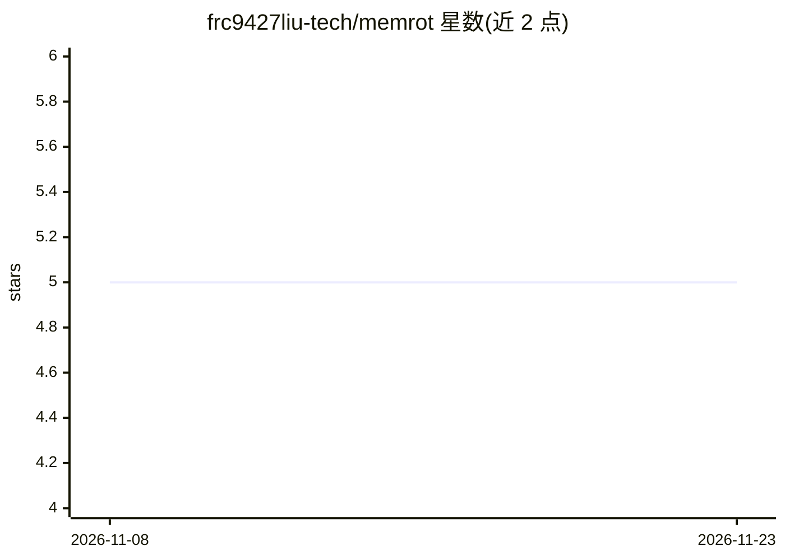

# frc9427liu-tech/memrot

⭐ 5 · JavaScript · MIT · 推送 2026-11-02 · [GitHub](https://github.com/frc9427liu-tech/memrot) · 个人维护 · 中文 README

**给 AI agent 用户检查 CLAUDE.md 等记忆文件中的过期与矛盾内容**

一个零依赖、单文件的本地 linter，针对 CLAUDE.md / AGENTS.md / MEMORY.md 及记忆文件夹执行规则检查：失效路径、失效命令、失效链接、同文件矛盾声明、重复行、超尺寸/超 token 预算、非法 UTF-8 编码、相对时间表述。token 估算对中日韩字符按约 1 token/字计算。检查发现错误级问题时以退出码 1 支持 CI 与 pre-commit 集成。--fix 仅做不丢失信息的修复（编码修复、去重），失效路径与矛盾交由人工处理。需要 Node 18+。

## 筛选速览

| 维度 | 判定 | 备注 |
|---|---|---|
| AI 角色 | `ai-ecosystem` | LLM/agent 周边工具 |
| 许可风险 | `permissive` | MIT |
| 部署形态 | `library` | 以包/库形式分发 |
| 模型依赖 | — | README 未给出锁定关系 |
| 硬件要求 | — | 无带数字的原话,不猜 |
| 安装摩擦 | `low` | 无编译、无系统依赖或容器化 |
| 成熟度 | — | 结构信号不足 |

## 能力要点

- 8 类规则：失效路径/命令/链接、矛盾、重复、超尺寸、编码、相对时间
- 零依赖单文件，全本地运行，不调用任何 AI 服务
- 退出码 1 可直接接入 CI 或 pre-commit hook
- --fix 支持修复 Big5/GBK/Shift-JIS 等编码损坏并去除重复行

## 适用场景

- 提交前检查 agent 记忆文件里引用的路径是否还存在
- 在 CI 中拦截超过 token 预算或含矛盾的 CLAUDE.md
- 修复被 agent 读取时报乱码的编码损坏记忆文件

## 场景标签

 · 领域:开发工具/代码质量检查

## 证据(README 行号)

> L7: A zero-dependency, fully local linter for `CLAUDE.md`, `AGENTS.md`, `MEMORY.md` and memory folders.
> L8: No AI calls, no cloud, no config. One file.
> L41: Exit code is `1` if there is any error-level finding, so it drops into CI or a pre-commit hook.

## 星数曲线

2026-11-08 5 → 2026-11-23 5（+0）

---
*卡片 v1 · prompt 1.4 · 生成 2026-11-21 · 置信度 high · 依据 README sha `836fa4203859` · [字段定义](../../DATASET.md)*
