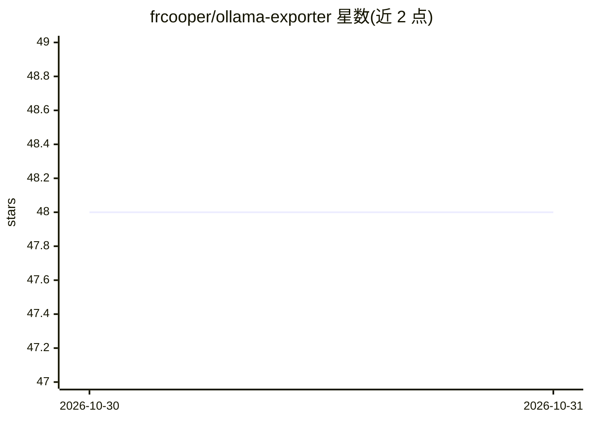

# frcooper/ollama-exporter

⭐ 48 · Python · Unlicense · 推送 2026-10-29 · [GitHub](https://github.com/frcooper/ollama-exporter) · 个人维护

**给 Ollama 的 Prometheus 指标采集器与透明转发代理**

部署在应用与 Ollama 之间的 HTTP 代理：应用将请求发给 exporter，exporter 转发到 Ollama 并在 /metrics 暴露 Prometheus 指标，覆盖每模型请求计数、响应/加载/评估耗时、token 处理与生成量、生成速率与在途请求数。支持全部 Ollama API 端点的透明流式转发（含 OpenAI 兼容 /v1/*），客户端断开时取消上游生成，可设每请求总时限。提供 Python 运行、Docker 与 WSL 容器三种方式，容器镜像需本地构建，随附两份 Grafana 面板。代理自身不加认证，需置于可信网络或反向代理之后。

## 筛选速览

| 维度 | 判定 | 备注 |
|---|---|---|
| AI 角色 | `ai-ecosystem` | LLM/agent 周边工具 |
| 许可风险 | `permissive` | Unlicense |
| 部署形态 | `desktop` | 安装包/桌面程序 |
| 模型依赖 | local-ok | 支持本地模型 |
| 硬件要求 | — | 无带数字的原话,不猜 |
| 安装摩擦 | `low` | 无编译、无系统依赖或容器化 |
| 成熟度 | — | 结构信号不足 |

## 能力要点

- 透明代理全部 Ollama API 端点（含 OpenAI 兼容 /v1/*）并采集 Prometheus 指标
- 每模型跟踪请求计数、耗时、token 处理/生成量与生成速率
- 客户端断开时取消上游生成，可配置每推理请求总时限
- 随附两份可导入的 Grafana 面板

## 适用场景

- 用 Prometheus + Grafana 监控本地 Ollama 实例的请求量与 token 使用
- 让 Open WebUI 等 OpenAI 兼容客户端经代理接入 Ollama 并留下指标
- 限制推理请求的运行时长并终止被放弃的生成任务

## 场景标签

`LLM 可观测性` · 领域:评测与运维

## 证据(README 行号)

> L3: A Prometheus exporter and HTTP proxy for Ollama. Point applications at the
> L8: Application -> Exporter :8000 -> Ollama :11434
> L9: Prometheus  -> Exporter :8000/metrics

## 星数曲线

2026-10-30 48 → 2026-10-31 48（+0）

---
*卡片 v1 · prompt 1.4 · 生成 2026-10-30 · 置信度 mid · 依据 README sha `64eb935574cb` · [字段定义](../../DATASET.md)*
