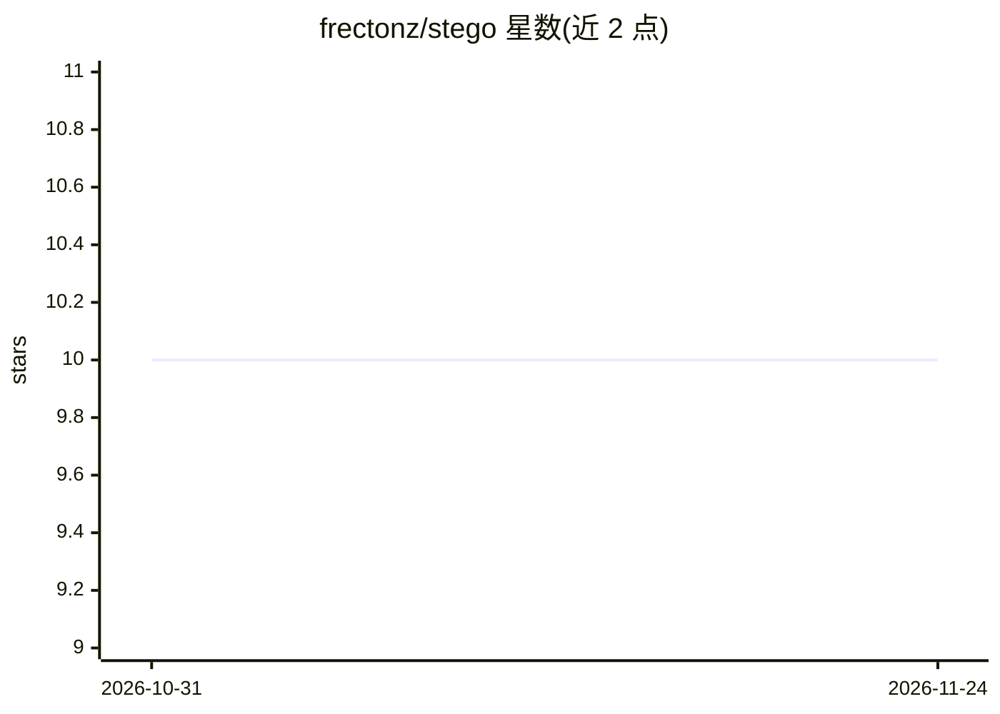

# frectonz/stego

⭐ 10 · Rust · MIT · 推送 2026-07-28 · [GitHub](https://github.com/frectonz/stego) · [官网](https://youtu.be/YEQPft_-9Rk) · 个人维护

**用 LLM 将密文藏入等长封面文本的 Rust 隐写工具**

基于论文《LLMs can hide text in other text of the same length》(Norelli & Bronstein, 2025) 的 Rust 实现：将秘密消息隐藏在同 token 长度的普通封面文本中，持有正确密钥时可精确恢复。README 可见内容仅提供项目定位与论文出处，未展示安装、运行方式及使用说明。

## 筛选速览

| 维度 | 判定 | 备注 |
|---|---|---|
| AI 角色 | `ai-native` | 本体是模型或模型工具 |
| 许可风险 | `permissive` | MIT |
| 部署形态 | `None` |  |
| 模型依赖 | — | README 未给出锁定关系 |
| 硬件要求 | — | 无带数字的原话,不猜 |
| 安装摩擦 | `low` | 无编译、无系统依赖或容器化 |
| 成熟度 | — | 结构信号不足 |

## 能力要点

- 将秘密消息嵌入同 token 长度的封面文本
- 凭正确密钥可精确恢复消息
- Rust 实现，基于已发表论文方法

## 适用场景

- 在普通文本中隐藏秘密消息
- 复现 LLM 文本隐写研究方法

## 场景标签

 · 领域:信息安全/隐写

## 证据(README 行号)

> L3: Hide a secret message inside an ordinary-looking cover text of the **same token
> L5: *LLMs can hide text in other text of the same length*

## 星数曲线

2026-10-31 10 → 2026-11-24 10（+0）

---
*卡片 v1 · prompt 1.4 · 生成 2026-11-19 · 置信度 mid · 依据 README sha `6afaf799125a` · [字段定义](../../DATASET.md)*
