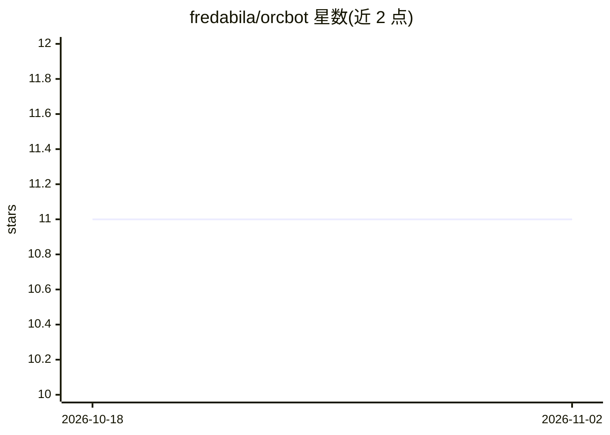

# fredabila/orcbot

⭐ 11 · TypeScript · MIT · 推送 2026-10-09 · [GitHub](https://github.com/fredabila/orcbot) · [官网](https://orcbot.buzzchat.site) · 个人维护

**多渠道自主任务 agent：规划执行工具并经消息渠道交付结果**

OrcBot 是本地运行的 TypeScript 自主 agent：以 supervisor 式循环规划多步任务、调用注册的技能工具（命令执行、浏览、搜索、文件、消息、图像生成、知识库语义检索），并通过 Telegram/WhatsApp/CLI 等渠道交付结果。支持预执行计划修复、工具失败后重规划、心跳调度与工作进程。附带自训练 sidecar：导出脱敏轨迹、离线评估候选模型、需管理员批准才能晋升。可通过 Docker、npm、一键脚本安装；本地模型经 Ollama 或 OpenAI 兼容接口接入。

## 筛选速览

| 维度 | 判定 | 备注 |
|---|---|---|
| AI 角色 | `ai-native` | 本体是模型或模型工具 |
| 许可风险 | `permissive` | MIT |
| 部署形态 | `desktop` | 安装包/桌面程序 |
| 模型依赖 | local-ok | 支持本地模型 |
| 硬件要求 | — | 无带数字的原话,不猜 |
| 安装摩擦 | `low` | 无编译、无系统依赖或容器化 |
| 成熟度 | — | 结构信号不足 |

## 能力要点

- supervisor 循环：计划修复、失败重规划、完成度复核
- 自训练 sidecar：轨迹导出→过滤→评估→管理员批准晋升
- 媒体输入、图像生成、检索增强知识库
- 硬件/机器人桥接参考架构（ROS2/MQTT/REST + 安全层）

## 适用场景

- 让 agent 通过 Telegram/WhatsApp 执行多步自动化任务
- 本地搭建带自学习与技能插件的个人助手
- 经桥接服务对接机器人或硬件做巡检任务

## 场景标签

`AI 助手` `图像生成` · 领域:对话与助手

## 证据(README 行号)

> L19: OrcBot plans multi-step tasks, runs registered tools, and delivers results through supported channels. The current 
> L44: * **Local models**: Manages Ollama models and supports OpenAI-compatible tool calling.
> L56: The system runs locally and connects to external channels and providers. This diagram shows the path from inbound m

## 星数曲线

2026-10-18 11 → 2026-11-02 11（+0）

---
*卡片 v1 · prompt 1.4 · 生成 2026-11-02 · 置信度 high · 依据 README sha `3faf4c64d14b` · [字段定义](../../DATASET.md)*
