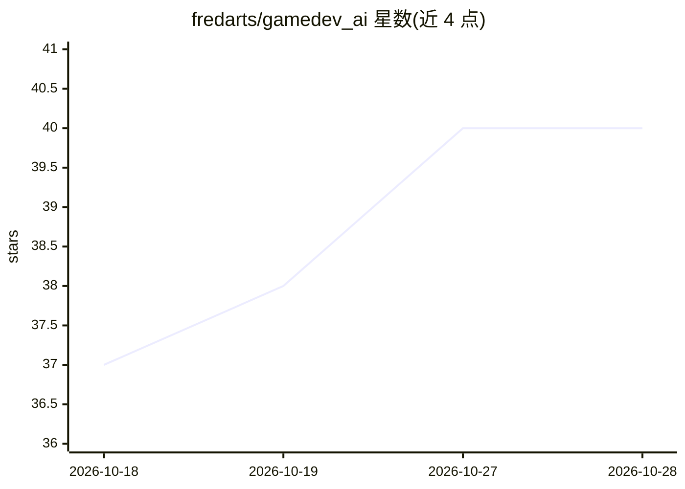

# fredarts/gamedev_ai

⭐ 40 · GDScript · MIT · 推送 2026-10-04 · [GitHub](https://github.com/fredarts/gamedev_ai) · [官网](https://fredarts.github.io/gamedev_ai/) · 个人维护

**Godot 4.7+ 编辑器 AI 编程助手插件，辅助游戏开发**

集成到 Godot 编辑器的 AI 开发插件：通过对话生成/修改 GDScript、操作节点树、审查 Diff 后应用变更、监控控制台错误并自动提出修复。提供本地 MCP 服务器（127.0.0.1:6543）供 Cursor、Claude Desktop 等外部工具接入 Godot，内置本地向量库索引项目脚本的 RAG 机制、25 个技能文档与 Git 集成。模型侧支持 Ollama/LM Studio 本地运行，也接入 Gemini、OpenRouter/OpenAI、NVIDIA NIM 等。安装方式为复制 addons 目录并在项目设置中启用插件。

## 筛选速览

| 维度 | 判定 | 备注 |
|---|---|---|
| AI 角色 | `ai-enhanced` | 去掉 AI 部分产品仍成立 |
| 许可风险 | `permissive` | MIT |
| 部署形态 | `None` |  |
| 模型依赖 | local-ok | 支持本地模型 |
| 硬件要求 | — | 无带数字的原话,不猜 |
| 安装摩擦 | `low` | 无编译、无系统依赖或容器化 |
| 成熟度 | — | 结构信号不足 |

## 能力要点

- 50+ Agentic 工具操作节点/脚本/着色器，Diff 预览后应用变更
- 内置 MCP 服务器与 stdio 桥，外部 AI 编程环境可直连 Godot
- 本地向量库索引脚本的 RAG 知识引擎与 25 个内置技能文档
- Watch Mode 监控引擎控制台错误并提出修复

## 适用场景

- 在 Godot 编辑器内通过对话生成和修改游戏代码
- 让外部 AI 编程工具（Cursor/Claude Desktop）直接操作 Godot 场景
- 游戏崩溃时获得自动修复建议

## 场景标签

`编码 Agent` · 领域:编码与开发

## 证据(README 行号)

> L14:  Write GDScript code, manipulate nodes, fix engine console errors automatically, and apply complex changes by revie

## 星数曲线

2026-10-18 37 → 2026-10-28 40（+3）

---
*卡片 v1 · prompt 1.4 · 生成 2026-10-25 · 置信度 mid · 依据 README sha `58d043d9cee7` · [字段定义](../../DATASET.md)*
