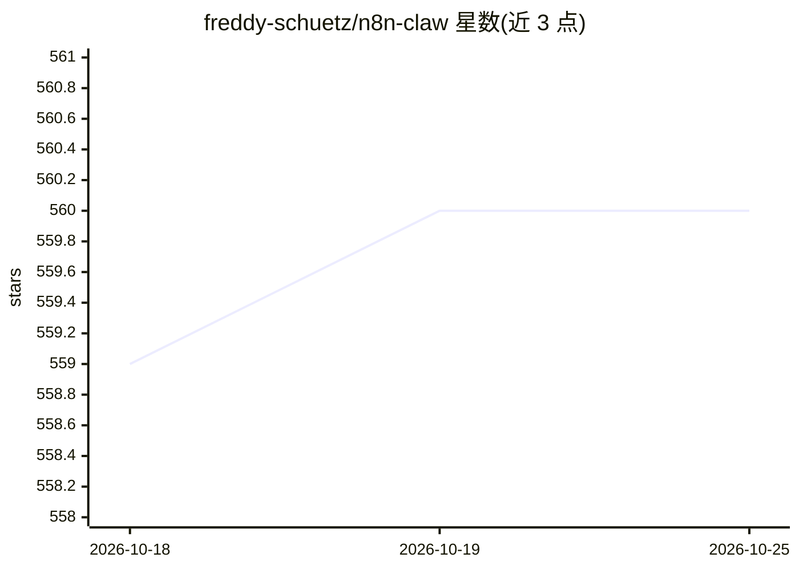

# freddy-schuetz/n8n-claw

⭐ 560 · Shell · 推送 2026-10-24 · [GitHub](https://github.com/freddy-schuetz/n8n-claw) · [官网](https://n8n-claw.com) · 个人维护

**自托管个人 AI agent：n8n 上运行，经 Telegram/HTTP 对话**

基于 n8n + PostgreSQL + LLM API（Anthropic 默认，可选 OpenAI/OpenRouter/DeepSeek/Gemini/Mistral/Ollama 等）构建的自治 agent，通过 Telegram 或 Webhook API 与用户对话。功能包括混合检索长期记忆、知识图谱、任务与提醒管理、定时/循环任务、SearXNG 网页搜索、Crawl4AI 网页读取、Browser Use 浏览器自动化（含 2FA 交互）、专家子代理与 MCP 技能。一键 setup.sh 脚本部署 Docker 环境，要求 Linux VPS（4GB RAM/15GB 磁盘）、Telegram Bot Token、LLM API key 与域名。MCP 接入存在 5 分钟超时、仅文本等限制。

## 筛选速览

| 维度 | 判定 | 备注 |
|---|---|---|
| AI 角色 | `ai-native` | 本体是模型或模型工具 |
| 许可风险 | `none` | — |
| 部署形态 | `self-host` | docker 或自建部署 |
| 模型依赖 | local-ok | 支持本地模型 |
| 硬件要求 | — | 无带数字的原话,不猜 |
| 安装摩擦 | `low` | 无编译、无系统依赖或容器化 |
| 成熟度 | — | 结构信号不足 |

## 能力要点

- 混合检索长期记忆（语义+全文+实体，RRF 融合，时间衰减与来源归因）
- Browser Use 驱动 Chromium 做浏览器自动化，支持 Telegram 交互式 2FA
- 专家子代理（内置 3 个，目录 12 类 100+ 可选）与 MCP 技能构建
- 通过 n8n 实例级 MCP Server 接入 Claude Desktop/ChatGPT/Cursor 等客户端

## 适用场景

- 在自有 VPS 上运行可对话的个人助理管理任务与提醒
- 通过 Telegram 或 HTTP API 从 Slack/Teams 等系统调用 agent
- 让 agent 定时执行网页搜索、邮件检查等后台任务
- 在 Claude Desktop/Cursor 等 MCP 客户端中直接调用该 agent

## 场景标签

`AI 助手` `Agent 记忆` `浏览器自动化` `知识图谱` · 领域:Agent 开发

## 证据(README 行号)

> L5: A fully self-hosted AI agent built on n8n + PostgreSQL + Claude. Talks to you via Telegram or HTTP API (Slack, Teams
> L15: Talk to your agent in natural language — it manages tasks, remembers context across conversations, builds API integ

## 星数曲线

2026-10-18 559 → 2026-10-25 560（+1）

---
*卡片 v1 · prompt 1.4 · 生成 2026-10-21 · 置信度 high · 依据 README sha `24e2cef4c235` · [字段定义](../../DATASET.md)*
