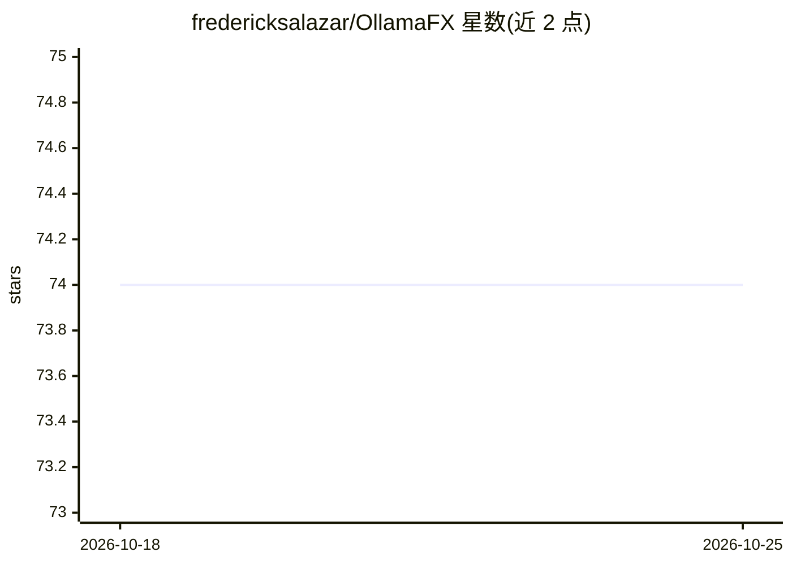

# fredericksalazar/OllamaFX

⭐ 74 · Java · MIT · 推送 2026-05-21 · [GitHub](https://github.com/fredericksalazar/OllamaFX) · [官网](https://fredericksalazar.wordpress.com/proyectos/ollamafx/) · 个人维护

**JavaFX 编写的 Ollama 本地模型管理与聊天桌面客户端**

基于 JavaFX 的 Ollama 桌面客户端，通过 ollama4j 与本地 Ollama 服务交互，界面风格参考 GNOME Adwaita，支持亮/暗模式。功能包括浏览 Ollama 模型库并实时进度下载、查看/卸载已装模型、多会话聊天（置顶/重命名/删除）。运行需 Java 17+ 和本地 Ollama（ollama serve）；Releases 提供跨平台 zip 分发包，各平台附带启动脚本，也可用 Gradle 从源码构建。

## 筛选速览

| 维度 | 判定 | 备注 |
|---|---|---|
| AI 角色 | `ai-ecosystem` | LLM/agent 周边工具 |
| 许可风险 | `permissive` | MIT |
| 部署形态 | `desktop` | 安装包/桌面程序 |
| 模型依赖 | local-ok | 支持本地模型 |
| 硬件要求 | — | 无带数字的原话,不猜 |
| 安装摩擦 | `medium` | 含编译或系统依赖之一 |
| 成熟度 | — | 结构信号不足 |

## 能力要点

- 浏览 Ollama 模型库并带实时进度下载
- 查看模型详情（大小/格式）并卸载
- 多会话聊天管理（置顶/重命名/删除）
- 亮/暗模式与 AtlantaFX 主题

## 适用场景

- 在桌面图形界面中管理本地 Ollama 模型
- 与本地 LLM 进行多会话对话
- 不习惯命令行时用 GUI 操作 Ollama

## 场景标签

`聊天机器人` · 领域:对话与助手

## 证据(README 行号)

> L8: **OllamaFX** is a modern, native desktop client for Ollama, built with JavaFX. It provides a beautiful, user-friendl
> L21: * **🛠️ Tech Stack:** Built on the robust JavaFX platform, utilizing `ollama4j` for API interaction and `AtlantaFX` 
> L42: * **Ollama** installed and running locally (`ollama serve`).

## 星数曲线

2026-10-18 74 → 2026-10-25 74（+0）

---
*卡片 v1 · prompt 1.4 · 生成 2026-10-24 · 置信度 high · 依据 README sha `ee400d408619` · [字段定义](../../DATASET.md)*
