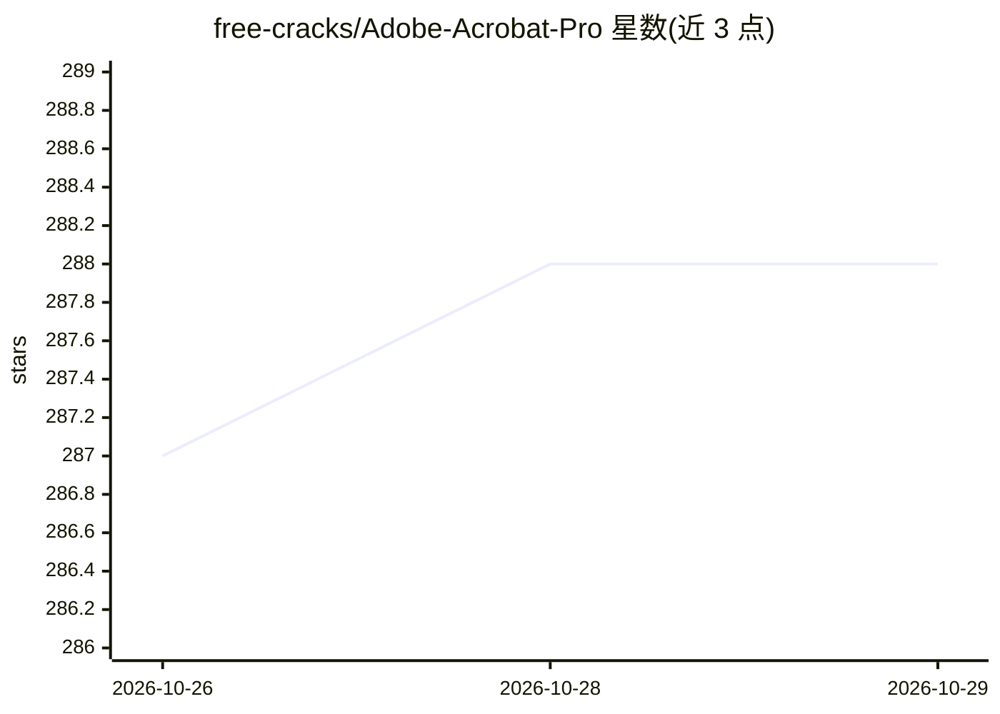

# free-cracks/Adobe-Acrobat-Pro

⭐ — · [GitHub]() · 个人维护

**Windows 上 Adobe Acrobat Pro 的预激活独立部署脚本包**

面向 Windows 10/11（x64）的 Adobe Acrobat Pro 独立部署工具，README 自称预激活（pre-activated）便携构建：通过 PowerShell 一键脚本下载约 1.5 GB 载荷、解包组件并配置本地 COM 库，实现离线的 PDF 转换（XML/HTML/DOCX/XLSX/TXT/RTF）与文档处理。脚本会绕过执行策略并要求暂停 Windows Defender 实时防护以完成安装；此行为在 README 中以排除误报方式说明。目标用户为 IT 管理员与高级用户。README 未描述任何实际 AI 模型能力，仅主题标签含 'ai'。

## 筛选速览

| 维度 | 判定 | 备注 |
|---|---|---|
| AI 角色 | `ai-enhanced` | 去掉 AI 部分产品仍成立 |
| 许可风险 | `none` | — |
| 部署形态 | `None` |  |
| 模型依赖 | — | README 未给出锁定关系 |
| 硬件要求 | — | 无带数字的原话,不猜 |
| 安装摩擦 | `low` | 无编译、无系统依赖或容器化 |
| 成熟度 | — | 结构信号不足 |

## 能力要点

- PowerShell 一键脚本下载并部署约 1.5 GB 预激活构建
- 通过 Acrobat COM 类型库实现 PDF 多格式转换与表格提取
- 宣称离线架构，无云端检查与遥测
- 安装过程包含执行策略绕过与 Defender 排除配置

## 适用场景

- 在 Windows 上离线部署 Acrobat Pro 进行 PDF 转换与处理
- 通过 COM 接口（.NET 4.6.1）二次开发 PDF 处理功能
- 批量提取 PDF 中的表格、文本与元数据

## 场景标签

 · 领域:PDF 文档处理/软件分发

## 证据(README 行号)

> L3: Standalone Windows deployment tool for automated PDF processing, conversion, and secure document management.
> L5: > **Distribution Type:** Pre-activated Standalone Build
> L12: **Acrobat Pro Suite** is a portable, offline-ready deployment package designed for IT administrators and power user

## 星数曲线

2026-10-26 287 → 2026-10-29 288（+1）

---
*卡片 v1 · prompt 1.4 · 生成 2026-10-27 · 置信度 low · 依据 README sha `8a90cbbb3d77` · [字段定义](../../DATASET.md)*
