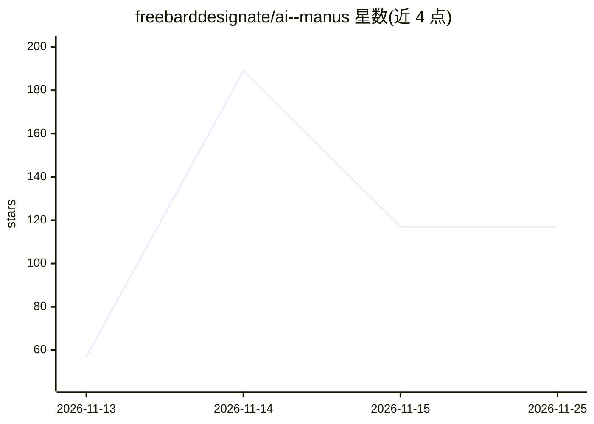

# freebarddesignate/ai--manus

⭐ 117 · Apache-2.0 · 推送 2026-11-15 · [GitHub](https://github.com/freebarddesignate/ai--manus) · 个人维护

**面向个人用户的自主 AI 代理，代跑代码与控制浏览器**

自称 Manus 的自主 AI 代理系统，宣传能力包括：代替用户编写并执行脚本、控制浏览器完成导航/填表/信息抓取、执行多步日常任务，定位为家庭、学习与轻度办公场景的个人助手，明确声明不是企业级平台。README 以功能描述与推广内容为主，提供 CPU/内存/存储的兼容性参考表与使用步骤说明，但未给出任何安装命令、代码仓库内容或技术实现细节，下载仅提及 Download 与 PROMO2026 字样，无实际链接可验证。

## 筛选速览

| 维度 | 判定 | 备注 |
|---|---|---|
| AI 角色 | `ai-native` | 本体是模型或模型工具 |
| 许可风险 | `permissive` | Apache-2.0 |
| 部署形态 | `None` |  |
| 模型依赖 | — | README 未给出锁定关系 |
| 硬件要求 | — | 无带数字的原话,不猜 |
| 安装摩擦 | `low` | 无编译、无系统依赖或容器化 |
| 成熟度 | — | 结构信号不足 |

## 能力要点

- 自主执行代码与脚本运行
- 浏览器控制：导航、填表、抓取信息
- 代码与浏览器动作在同一任务流中衔接
- 面向家庭/学习/轻办公的小规模任务

## 适用场景

- 让学生整理研究笔记、跑小脚本
- 代替人工跨网页收集信息、填重复表单
- 把小项目中的重复步骤委托给后台代理

## 场景标签

`AI 助手` `浏览器自动化` `编码 Agent` · 领域:效率与自动化

## 证据(README 行号)

> L10: - **Autonomous Code Execution:** Manus AI agent runs code on its own to complete tasks, so you can focus on decisio
> L18: Manus is an autonomous AI agent designed to run code and control a browser on your behalf. Instead of acting like a

## 星数曲线

2026-11-13 57 → 2026-11-25 117（+60）

---
*卡片 v1 · prompt 1.4 · 生成 2026-11-17 · 置信度 low · 依据 README sha `a3d88e202bf0` · [字段定义](../../DATASET.md)*
