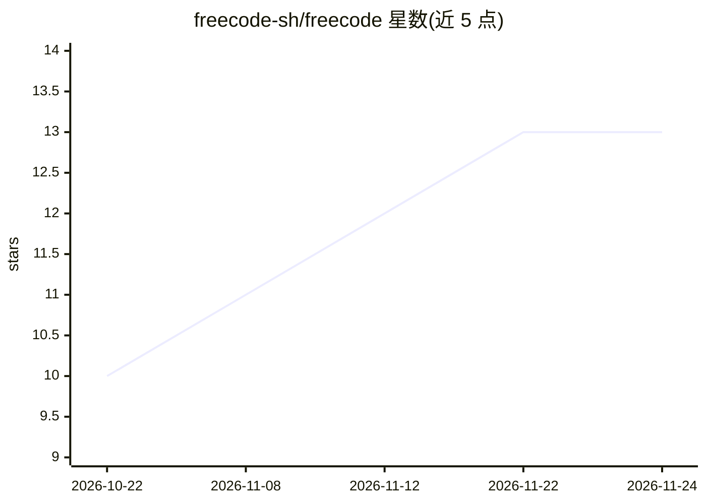

# freecode-sh/freecode

⭐ 14 · 推送 2026-09-11 · [GitHub](https://github.com/freecode-sh/freecode) · [官网](https://freecode.sh) · 组织维护

**面向初级/中级程序员的终端免费编码 agent**

freecode 是一个运行在终端里的编码 agent，定位为免费产品，面向初级和中级程序员，帮助构建、理解和改进软件。README 声明产品当前处于 alpha 阶段，可能存在不完善之处。本仓库为公共社区仓库，承载 issue、讨论、产品信息与社区文档；产品源码目前在私有仓库中开发，未在此镜像，欢迎对公共文档与社区模板提交 PR。安装方式为 npm 全局安装或通过官网获取原生安装器。

## 筛选速览

| 维度 | 判定 | 备注 |
|---|---|---|
| AI 角色 | `ai-native` | 本体是模型或模型工具 |
| 许可风险 | `none` | — |
| 部署形态 | `library` | 以包/库形式分发 |
| 模型依赖 | — | README 未给出锁定关系 |
| 硬件要求 | — | 无带数字的原话,不猜 |
| 安装摩擦 | `low` | 无编译、无系统依赖或容器化 |
| 成熟度 | `idea` | |

## 能力要点

- 终端内运行的编码 agent，免费提供
- npm 全局安装，另有官网原生安装器
- 公共社区仓库承载 issue、讨论与社区文档
- 产品处于 alpha 阶段，征集用户反馈

## 适用场景

- 在终端中让 agent 协助编写和改进代码
- 初学者借助 agent 理解现有软件项目
- 通过 issue 与讨论参与产品社区反馈

## 场景标签

`编码 Agent` `AI 助手` · 领域:编码与开发

## 证据(README 行号)

> L5: freecode is a free coding agent for your terminal. It is designed to help beginner and intermediate programmers buil
> L30: This is freecode's public community repository. It hosts public issues, discussions, product information, and commu

## 星数曲线

2026-10-22 10 → 2026-11-24 13（+3）

---
*卡片 v1 · prompt 1.4 · 生成 2026-11-18 · 置信度 mid · 依据 README sha `4b0d622025f9` · [字段定义](../../DATASET.md)*
