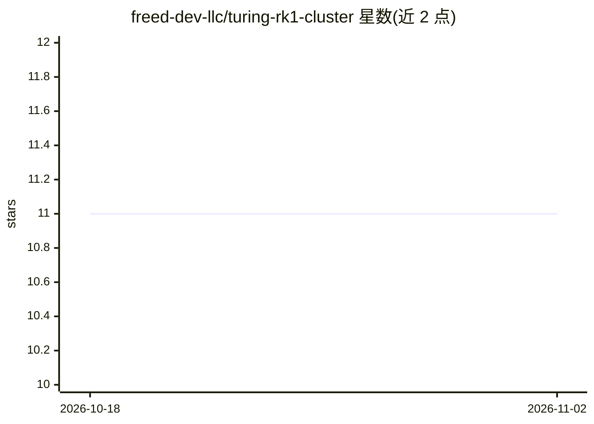

# freed-dev-llc/turing-rk1-cluster

⭐ 11 · Shell · Apache-2.0 · 推送 2026-10-29 · [GitHub](https://github.com/freed-dev-llc/turing-rk1-cluster) · [官网](https://github.com/freed-dev-llc/turing-rk1-cluster) · 组织维护

**Turing RK1 四节点裸机 Kubernetes 集群的部署与运维配置库**

在 Turing Pi 2 板卡上以 4 块 RK3588 计算模块组建裸机集群的配置仓库：支持 Talos Linux 与 Armbian 上的 K3s 两种发行路径，配套 Longhorn 分布式存储、MetalLB/NGINX Ingress 网络、Prometheus/Grafana 监控栈。当前实际部署为 K3s 路径，通过 exo-rkllama DaemonSet 在各节点 RK3588 NPU 上提供 LLM 推理（OpenAI 兼容 API），并带模型预载 CronJob 自愈机制。限制：实例状态易失，重启不自动恢复；NPU 支持在 Talos 路径为部分可用。

## 筛选速览

| 维度 | 判定 | 备注 |
|---|---|---|
| AI 角色 | `ai-ecosystem` | LLM/agent 周边工具 |
| 许可风险 | `permissive` | Apache-2.0 |
| 部署形态 | `None` |  |
| 模型依赖 | — | README 未给出锁定关系 |
| 硬件要求 | — | 无带数字的原话,不猜 |
| 安装摩擦 | `low` | 无编译、无系统依赖或容器化 |
| 成熟度 | — | 结构信号不足 |

## 能力要点

- Talos 与 K3s 双发行路径，脚本化部署与擦除
- exo-rkllama DaemonSet 在 RK3588 NPU 上运行 LLM 推理并提供 OpenAI 兼容 API
- 自愈模型预载 CronJob：按节点确保实例加载、幂等调度
- Longhorn 分布式存储 + MetalLB/Ingress + Prometheus/Grafana 全套配置清单

## 适用场景

- 在 ARM64 边缘硬件上自建裸机 Kubernetes 集群
- 用 RK3588 NPU 集群跑本地 LLM 推理服务
- homelab 场景下实践分布式存储与监控运维

## 场景标签

`推理引擎` · 领域:训练与推理

## 证据(README 行号)

> L19: A 4-node bare-metal Kubernetes cluster built on Turing RK1 compute modules, supporting both **Talos Linux** and **K
> L219: The cluster runs exo-rkllama as a
> L220: DaemonSet in the `exo-rk` namespace, serving LLM inference on each node's RK3588 NPU.

## 星数曲线

2026-10-18 11 → 2026-11-02 11（+0）

---
*卡片 v1 · prompt 1.4 · 生成 2026-11-02 · 置信度 mid · 依据 README sha `66aaf35ec8d4` · [字段定义](../../DATASET.md)*
