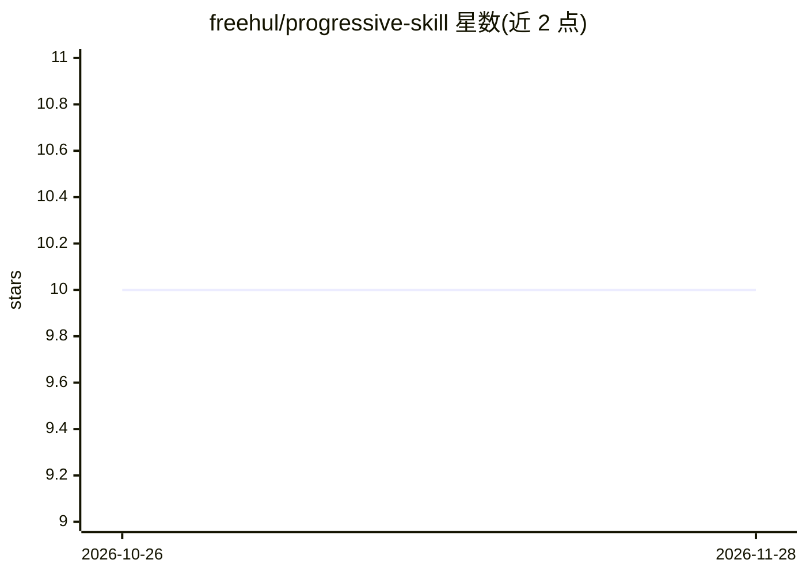

# freehul/progressive-skill

⭐ 10 · Python · MIT · 推送 2026-10-14 · [GitHub](https://github.com/freehul/progressive-skill) · 个人维护 · 中文 README

**为 agent 压缩技能索引的插件：省约70% token**

面向 Hermes Agent 的插件，同时提供可被任意 agent 使用的通用决策核心。针对技能列表膨胀导致系统提示 token 固定开销增大的问题，通过三层机制压缩技能索引：工具集→类别的降级注入、基于使用频率的时间衰减打分、可配置的 token 硬预算截断；降级类别仍保留为单行计数，可通过 skills_list 完整发现。决策逻辑为纯规则、零 LLM 调用。注意：README 声明项目已停止更新，方案已并入 SGME 的 skills 模块。

## 筛选速览

| 维度 | 判定 | 备注 |
|---|---|---|
| AI 角色 | `ai-ecosystem` | LLM/agent 周边工具 |
| 许可风险 | `permissive` | MIT |
| 部署形态 | `None` |  |
| 模型依赖 | — | README 未给出锁定关系 |
| 硬件要求 | — | 无带数字的原话,不猜 |
| 安装摩擦 | `low` | 无编译、无系统依赖或容器化 |
| 成熟度 | — | 结构信号不足 |

## 能力要点

- 渐进式披露+预算控制+使用频率学习三层机制，索引 token 约 -70%
- agent 无关决策核心（纯 Python，零 agent 依赖），经 cli.py 驱动任意 agent
- 零 LLM 决策：全部为规则逻辑，快速且 token 可预测
- 安全降级设计：上游签名变更时插件透明回退，不中断 agent 循环

## 适用场景

- 安装了大量技能导致系统提示 token 开销过高的 Hermes agent 用户
- Claude Code 等其他 agent 用户按使用频率压缩技能索引
- 需要在固定 token 预算内保留常用技能完整描述的场景

## 场景标签

`Agent 框架` · 领域:Agent 开发

## 证据(README 行号)

> L6: **Smart skill index compaction** with progressive disclosure, budget control, and usage-frequency learning — **works
> L16: - **Hermes**: a thin backend plugin (`__init__.py`) installed via `hermes plugins install freehul/progressive-skill
> L17: - **Any other agent (Claude Code, Codex, ...)**: drive the same decisions through the bundled `cli.py` — see Univer

## 星数曲线

2026-10-26 10 → 2026-11-28 10（+0）

---
*卡片 v1 · prompt 1.4 · 生成 2026-11-19 · 置信度 high · 依据 README sha `87c6e1ff3498` · [字段定义](../../DATASET.md)*
