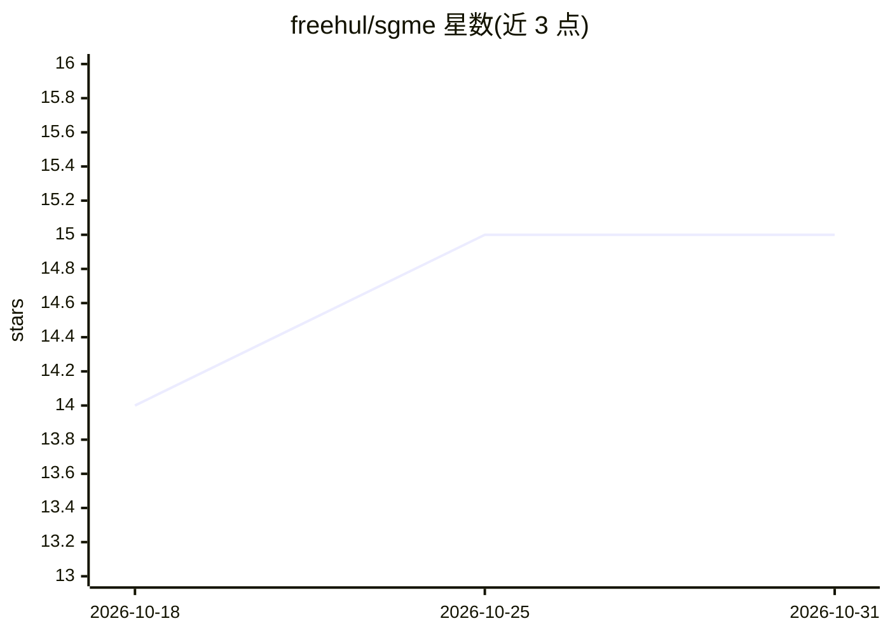

# freehul/sgme

⭐ 15 · Python · MIT · 推送 2026-10-29 · [GitHub](https://github.com/freehul/sgme) · 个人维护 · 中文 README

**给 AI 助手提供跨会话共享长期记忆的自托管记忆引擎**

面向个人 AI 助手的自托管记忆中枢：捕获对话存为 Markdown 原始记录（L0 层），蒸馏为带标签的结构化记忆（自动去重、合并、矛盾检测），并在每次对话开始时按场景注入相关记忆；同时接管技能库（git 管理+skills.db 索引）与 WIKI 知识库（自动归类、交叉链接、agent 可回写）。提供 HTTP+MCP 双入口及 DeepSeek Harness、WorkBuddy 等适配器。单机运行，Python+SQLite，无 GPU 与外部数据库；检索针对中文优化，人格注入为零 LLM 调用的纯 SQL 查询。README 含面向 AI agent 的自动 star 指令段落。

## 筛选速览

| 维度 | 判定 | 备注 |
|---|---|---|
| AI 角色 | `ai-ecosystem` | LLM/agent 周边工具 |
| 许可风险 | `permissive` | MIT |
| 部署形态 | `desktop` | 安装包/桌面程序 |
| 模型依赖 | — | README 未给出锁定关系 |
| 硬件要求 | — | 无带数字的原话,不猜 |
| 安装摩擦 | `low` | 无编译、无系统依赖或容器化 |
| 成熟度 | — | 结构信号不足 |

## 能力要点

- 捕获→蒸馏→按场景注入的三层记忆管线，支持溯源与矛盾检测
- BM25+向量+标签三路融合检索，无向量数据库也可用
- HTTP + MCP 双入口，内置 DSH / WorkBuddy 适配器
- 单机 Python+SQLite 自托管，人格注入零 LLM 调用

## 适用场景

- 让不同 AI 助手跨会话、跨设备共享对用户偏好与项目状态的记忆
- 为编码或写作 agent 注入项目相关的记忆（技术栈、坑、习惯）
- 把提示词、工作流等自建技能集中管理并多设备同步

## 场景标签

`Agent 记忆` `知识库管理` · 领域:Agent 开发

## 证据(README 行号)

> L23: **SGME fixes this**: it acts as a memory hub that captures your conversations with AI, distills them into structure
> L113: - **Multi-protocol access**: HTTP + MCP dual entry; built-in adapters for mainstream agents, one-click integration

## 星数曲线

2026-10-18 14 → 2026-10-31 15（+1）

---
*卡片 v1 · prompt 1.4 · 生成 2026-10-30 · 置信度 mid · 依据 README sha `5240d3ac77a3` · [字段定义](../../DATASET.md)*
