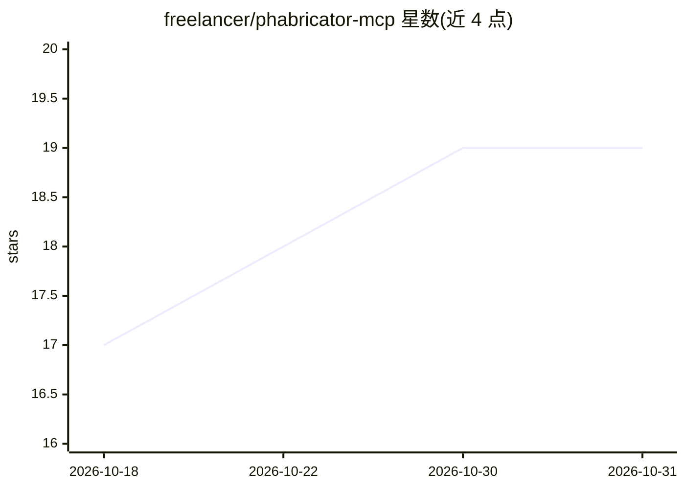

# freelancer/phabricator-mcp

⭐ 19 · TypeScript · 推送 2026-10-26 · [GitHub](https://github.com/freelancer/phabricator-mcp) · [官网](https://freelancer.github.io/phabricator-mcp/) · 组织维护

**封装 Phabricator Conduit API 的 MCP server，供 AI 客户端操作任务与代码审查**

用 TypeScript 编写的 MCP (Model Context Protocol) server，将 Phabricator 的 Conduit API 暴露为 MCP 工具，覆盖任务(Maniphest)、代码审查(Differential)、仓库(Diffusion)、项目、Wiki、博客、文件、构建、聊天等应用，共数十个工具。通过 npx 以 npm 包安装，配置从 ~/.arcrc 或环境变量读取，支持 Claude Code、Codex、opencode、VS Code、Cursor、GitHub Copilot 等客户端接入。服务器通过 conduit.query 探测实例可用方法并缓存，隐藏实例不支持的工具。由 Freelancer 组织维护，MIT 许可。

## 筛选速览

| 维度 | 判定 | 备注 |
|---|---|---|
| AI 角色 | `ai-ecosystem` | LLM/agent 周边工具 |
| 许可风险 | `none` | — |
| 部署形态 | `library` | 以包/库形式分发 |
| 模型依赖 | locked-api |  |
| 硬件要求 | — | 无带数字的原话,不猜 |
| 安装摩擦 | `low` | 无编译、无系统依赖或容器化 |
| 成熟度 | — | 结构信号不足 |

## 能力要点

- 覆盖 Maniphest/Differential/Diffusion/Phriction/Phame 等十余类 Phabricator 应用的 MCP 工具
- 通过 conduit.query 自动探测实例可用方法并缓存于 ~/.cache/phabricator-mcp/
- 配置自动读取 Arcanist 的 ~/.arcrc，环境变量优先
- 提供 Claude Code/Codex/opencode/VS Code/Cursor/Copilot 六种客户端接入配置

## 适用场景

- 用自然语言让 AI 助手查询、创建、编辑 Phabricator 任务
- 让 AI 助手浏览 diff、留行内评论并发布代码审查
- 让 AI 助手查仓库文件、构建结果与活动流

## 场景标签

`代码审查` · 领域:编码与开发

## 证据(README 行号)

> L3: An MCP (Model Context Protocol) server that wraps Phabricator's Conduit API, enabling any MCP client to interact wit
> L354: - `src/index.ts` - Entry point, MCP server with stdio transport

## 星数曲线

2026-10-18 17 → 2026-10-31 19（+2）

---
*卡片 v1 · prompt 1.4 · 生成 2026-10-29 · 置信度 high · 依据 README sha `2572bf6bae6c` · [字段定义](../../DATASET.md)*
