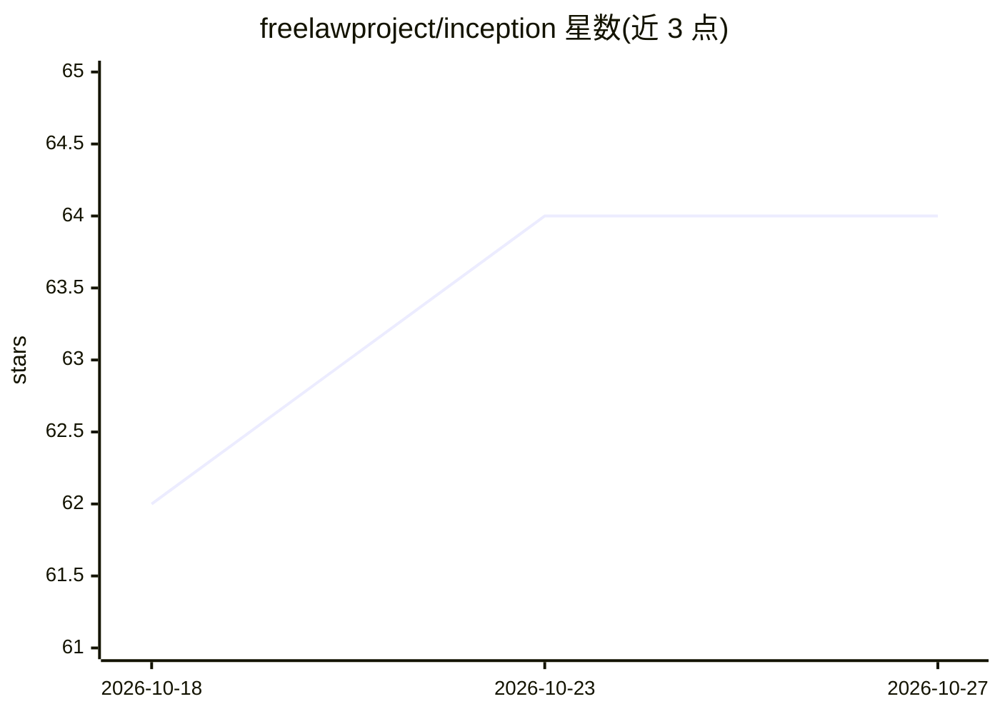

# freelawproject/inception

⭐ 64 · Python · BSD-2-Clause · 推送 2026-09-04 · [GitHub](https://github.com/freelawproject/inception) · 组织维护

**法律文本嵌入生成微服务：为检索查询与法院判决生成语义向量**

FreeLaw Project 维护的 FastAPI 微服务，基于 SentenceTransformers 模型（freelawproject/modernbert-embed-base_finetune_512）从文本块生成嵌入。面向法律文档与检索场景：搜索查询走 CPU 快速路径，长篇法院判决走 CUDA GPU 加速并按句子边界智能分块；提供批量处理、法律文本清洗、健康检查与 Prometheus 指标端点。通过 Docker（含托管镜像）或 UV 从源码安装运行，支持环境变量配置分块参数与并发。

## 筛选速览

| 维度 | 判定 | 备注 |
|---|---|---|
| AI 角色 | `ai-native` | 本体是模型或模型工具 |
| 许可风险 | `permissive` | BSD-2-Clause |
| 部署形态 | `self-host` | docker 或自建部署 |
| 模型依赖 | — | README 未给出锁定关系 |
| 硬件要求 | — | 无带数字的原话,不猜 |
| 安装摩擦 | `low` | 无编译、无系统依赖或容器化 |
| 成熟度 | — | 结构信号不足 |

## 能力要点

- 基于 SentenceTransformers 的法律文本专用微调嵌入模型
- 查询走 CPU、长文档走 GPU 加速的双路径设计
- 按句子边界的智能分块与重叠控制
- Docker/托管镜像部署，Prometheus 指标与 Sentry 错误跟踪

## 适用场景

- 为法律文档语义检索系统生成向量
- 批量处理法院判决等长文本嵌入
- 作为搜索查询的快速嵌入服务

## 场景标签

`语义搜索` · 领域:知识与检索

## 证据(README 行号)

> L5: Inception is our microservice for generating embeddings from blocks of text.
> L7: It is a high-performance FastAPI service that generates text embeddings using SentenceTransformers, specifically des
> L15: - Specialized text embedding generation for legal documents using `freelawproject/modernbert-embed-base_finetune_51

## 星数曲线

2026-10-18 62 → 2026-10-27 64（+2）

---
*卡片 v1 · prompt 1.4 · 生成 2026-10-24 · 置信度 mid · 依据 README sha `7a68147e3218` · [字段定义](../../DATASET.md)*
