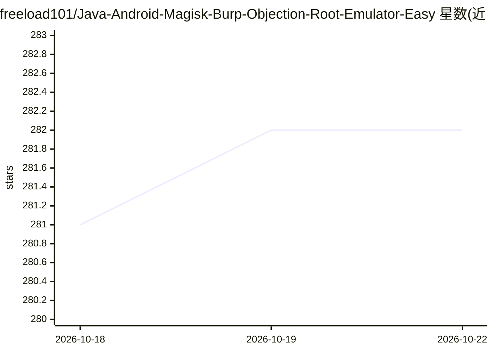

# freeload101/Java-Android-Magisk-Burp-Objection-Root-Emulator-Easy

⭐ 282 · PowerShell · GPL-3.0 · 推送 2026-10-21 · [GitHub](https://github.com/freeload101/Java-Android-Magisk-Burp-Objection-Root-Emulator-Easy) · [官网](http://JAMBOREE.rmccurdy.com) · 个人维护

**给渗透测试者的免管理员 Windows 便携安全工具安装器**

JAMBOREE 是一个开源 PowerShell 脚本驱动的便携安装器：在无本地管理员权限的 Windows 上快速搭建 Android 应用测试环境（Android 11 AVD + Magisk Root + Frida/Objection + Burp/ZAP 代理），并预配便携 Python/Git/Java 环境，所有组件从上游源下载、不打包二进制。可选工具集还收录 BloodHound、Volatility3、AUTOMATIC1111、AutoGPT、Ollama（WSL）等安全与 AI 工具，通过 PowerShell UI 启动。AVD 需 WSL 或虚拟机平台及 HAXM/AMD 驱动。面向安全测试人员，AI 工具仅为可选附带组件。

## 筛选速览

| 维度 | 判定 | 备注 |
|---|---|---|
| AI 角色 | `ai-enhanced` | 去掉 AI 部分产品仍成立 |
| 许可风险 | `viral` | GPL-3.0 |
| 部署形态 | `desktop` | 安装包/桌面程序 |
| 模型依赖 | — | README 未给出锁定关系 |
| 硬件要求 | — | 无带数字的原话,不猜 |
| 安装摩擦 | `low` | 无编译、无系统依赖或容器化 |
| 成熟度 | — | 结构信号不足 |

## 能力要点

- 免本地管理员权限搭建便携 Python/Git/Java 环境
- Android 11 AVD + Magisk Root + Frida/Objection + Burp/ZAP 一键预配
- 无打包二进制，全部从上游源下载
- 可选工具集含 BloodHound、Volatility3、AUTOMATIC1111、Ollama 等

## 适用场景

- 在没有管理员权限的机器上快速搭建 Android 应用渗透测试环境
- 通过 PowerShell UI 启动 Burp 与 AVD 测试目标 App
- 附带安装 BloodHound、Wazuh 等安全运营工具

## 场景标签

 · 领域:信息安全/渗透测试工具

## 证据(README 行号)

> L5: JAMBOREE, originally an Android Testing Suite, has expanded. **Completely Portable** installer for a growing collect
> L11: Portable, no-admin installer that provisions a Windows environment for Android app testing (AVD + Magisk + Frida + 
> L33: - Optional tools collection: BloodHound (portable), PyCharm Portable, AUTOMATIC1111, AutoGPT, Volatility3, yt-dlp, 

## 星数曲线

2026-10-18 281 → 2026-10-22 282（+1）

---
*卡片 v1 · prompt 1.4 · 生成 2026-10-22 · 置信度 high · 依据 README sha `a4ef05a793ed` · [字段定义](../../DATASET.md)*
